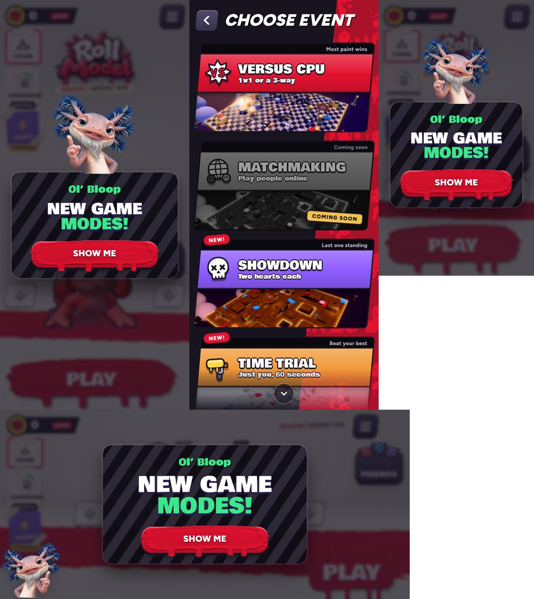

# New game modes card, short (v282)

Ol' Bloop's "New game modes!" card in the lobby (v273) is now just the title and **Show me**. The paragraph about Time trial and
Showdown and the Later link are gone. Show me still opens Choose event with the two new modes tagged New, and the card still shows
only once. Built in `tools/v282_modes_short.py`. The cards' shared filler (`tutCardText`) now hides the paragraph when a card has
none, so other cards are unchanged.
