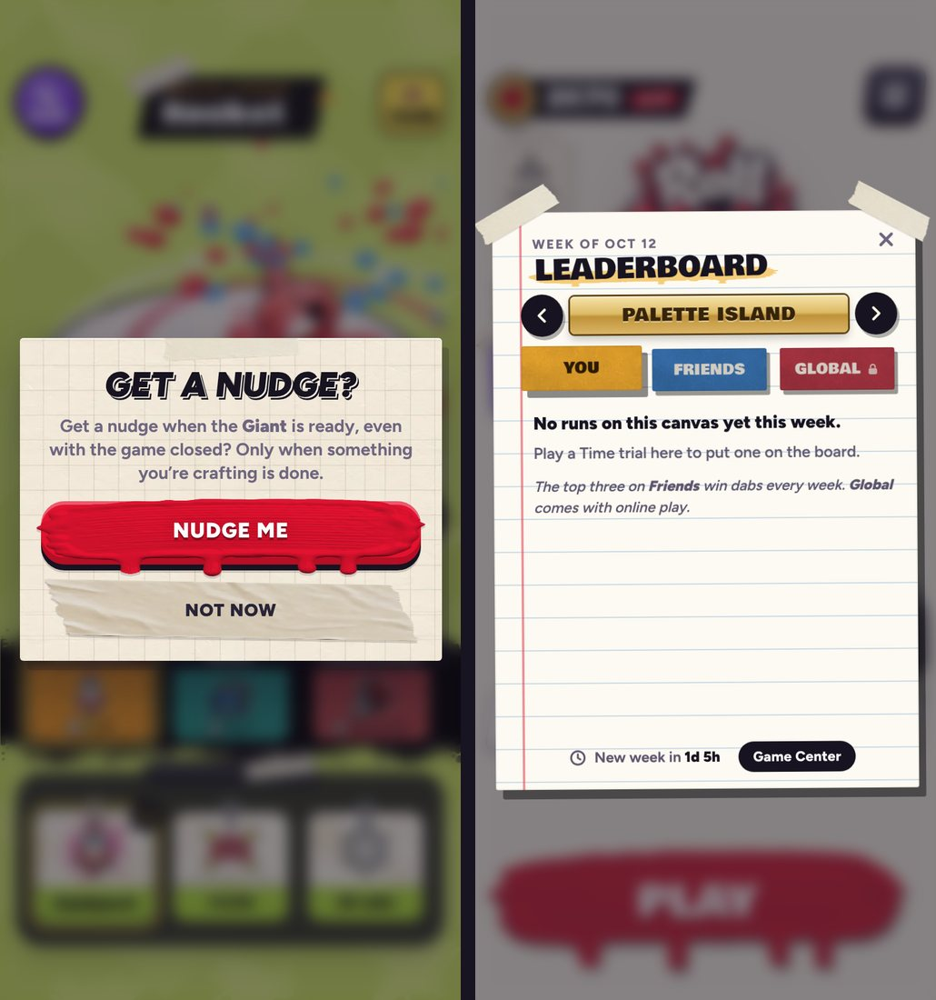

# v351: more of the iPhone

The game now uses more of the iPhone it runs on. The iOS app has the matching changes (see the iOS README).

- **Haptics that feel like iOS's own:**
  - **Success:** a win, a purchase, a claimed reward and a finished craft.
  - **Error:** a purchase that can't go through, and an ad that didn't come.
  - **A light tick when a choice changes:** Settings' switches, the difficulty, the tabs, the shop's filters, a paint colour and the canvas in the middle of the vote.
  - They follow the phone's own System Haptics setting. In a browser they're short buzzes.
- **The App Store's rating prompt** comes up back in the lobby after a win.
  - Only once the player has 3 wins and 8 matches, and once per game build.
  - iOS decides whether it shows: at most three times a year, never in TestFlight.
  - It's never rewarded.
- **A nudge when a craft is done:**
  - The first long craft asks in the game's own card: "Get a nudge when the Giant is ready, even with the game closed?" (**Nudge me** / **Not now**). It asks once, and never in Ol' Bloop's lesson.
  - Only **Nudge me** brings up iOS's permission prompt.
  - After that, each craft schedules a notification for when it's done ("The Giant is ready!"). Finishing it in the game first (Skip, or the game was open) calls it off.
- **Game Center:**
  - The player is signed in from the lobby, never mid-match and not before the first lesson is done.
  - A Time trial's score goes on that canvas's Game Center leaderboard.
  - The Time trial board gets a **Game Center** button once that canvas's leaderboard exists. The README lists the seven leaderboard IDs to make in App Store Connect; until then nothing of it shows.
- **Ads:**
  - When the game gives up waiting for an ad, it tells the app to stop waiting too, so the ad can't pop up later.
  - A reward still counts if iOS had to start the game's page over while the ad was up.
- **Sound** asks iOS for "ambient", as the app does: it plays alongside the player's music and follows the silent switch.
- **No long-press menu** anywhere but in text boxes.
- **The App Store build hides developer tools.** There are no error lines on screen or in Settings, and no hidden performance readout (five taps on the version line). A build run from Xcode and the browser keep them.

## Tested
In the preview build, against a stand-in for the iPhone app that records every message the game sends it, and in a plain browser. 33 checks, all pass:
- **The App Store build:**
  - error lines are hidden;
  - five taps on the version line do nothing;
  - the game asks whether notifications are allowed at launch;
  - Game Center sign-in is asked for from the lobby.
- **Haptics:**
  - a new choice in Settings ticks once (the same choice doesn't);
  - a shop filter ticks;
  - a purchase gives success, and one with too few dabs gives error;
  - an ad that didn't come gives error;
  - a real win gives success as the verdict lands, and a loss doesn't.
- **The nudge:**
  - the first long craft shows the card, naming the Giant;
  - Nudge me brings up iOS's prompt;
  - once allowed, the craft's nudge is scheduled for its end ("The Giant is ready!");
  - Skip calls it off, with the success feel;
  - the next craft schedules its nudge without asking again.
- **Ads:** a reward that reaches a page which lost track of the ad still finishes the craft.
- **Rating prompt:**
  - back in the lobby from a real win, it's asked for and kept as asked for this build;
  - it isn't asked for again in the same build;
  - a loss doesn't ask.
- **Game Center:**
  - the button shows on a canvas with a leaderboard and opens it, and stays hidden on one without;
  - a Time trial's score (33%) went on `rm.trial.crypt`.
- **No long-press menu,** except in text boxes.
- **The browser:**
  - haptics fall back to buzzes;
  - no Game Center or notifications;
  - the performance readout still opens.
- **No page errors.**
