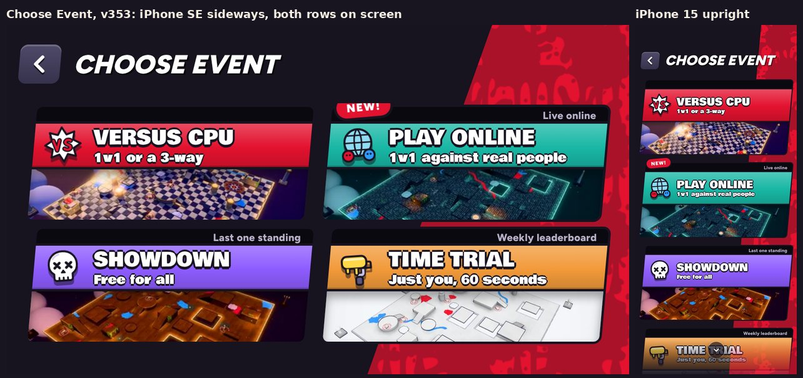

# v353: Season Conquest stays out of the launch

- **Season Conquest is gone from the game.** It does not launch with it, not even as "Coming soon".
  - Its card is off the Choose Event page, along with the message a tap on it gave and the picture it showed.
  - The game now has no "Conquest" anywhere in it.
- **Nothing of Conquest is deleted.**
  - The card's module, `tools/v300_quiet_hold_conquest.py`, stays in the build. It also carries the quiet results and the hold fix.
  - A new module, `tools/v353_no_conquest.py`, takes the card back out after it.
  - The Conquest work itself has been out of the build since v320 and is untouched, along with its docs. That's the Sunken Keep, its boss, the boss demo and their polish: `v309_conquest_stage.py`, `v311_conquest_boss.py`, `v315_boss_demo.py` and the v316 to v319 modules.
- **To bring the card back:** take `'v353_no_conquest'` off the module list in `tools/q260.py`.
- **Choose Event now has four events:** Versus CPU, Play Online, Showdown and Time trial.
  - **Sideways on a small phone** (iPhone SE, 15, 16), the cards are a little shorter, so both rows fit on the screen. Nothing fades out and no arrow says there's more below.
  - **Larger phones and upright:** unchanged.

## Tested
- The built game has no "Conquest" in it, and Choose Event shows the four events.
  - **Sideways:** iPhone SE, 15 and 15 Pro Max, with the whole page fitting on the screen.
  - **Upright:** iPhone 15.
- **v352's checks** still pass on this build: 25 of 25.
- **No page errors.**
