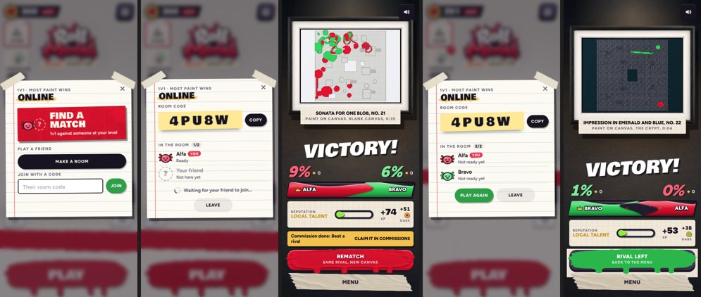
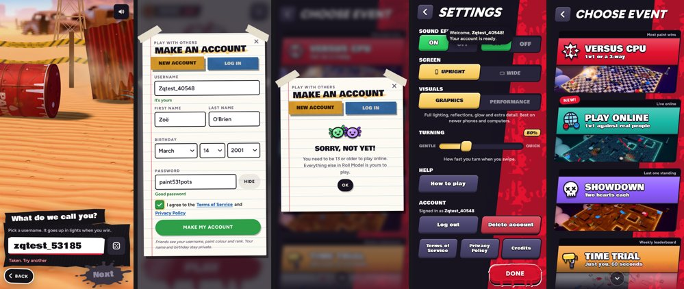

# v306: Online duels and accounts

Roll Model can now be played one against one with a real person over the internet. The game server runs on Fly.io
(`wss://rollmodel-game.fly.dev/ws`); usernames, accounts and friends live in the game's Supabase project. How the
server works, its rules and how to deploy it are in `docs/multiplayer.md`; the database is in `supabase/README.md`.

## Usernames and accounts

- **A username from the first launch.** The intro's name card checks the name as it's typed: 3 to 16 letters, digits
  or `_`, at least one letter (the game keeps names to 12 so they fit the name tags), nothing rude however it's spelt,
  no names that pretend to be staff, and not taken ("Checking…", "It's yours", "Taken. Try another"). The dice only
  rolls usernames that can be had. Offline, the intro goes on and the name is checked later.
- **An account to play with others.** Friends and online play need one: username, first and last name, birth year (13 or
  older; v307: the year only, counted as its last day so 13 is certain), a password (8 or more characters with a letter and a number), and a box to agree to the Terms of Service and
  the Privacy Policy, which open over the form but don't have to be read. Under 13: "Sorry, not yet", and nothing is
  made. The account is made from the player you already are, so your friend code and friends carry over.
- **Log in on another phone** with your username and password (Settings, Friends, or Play online). Settings has an
  Account row: who's signed in, Log out, and Delete account (asks first; deletes everything and frees the username).
- **Play online** (the old Matchmaking card on Choose Event) unlocks once you've opened the Strokes page.
- **In the Claude app's web preview** none of this can work: the preview lets a page talk to nothing outside it. Since v307 the
  game notices (the browser reports each connection it turns away) and says accounts, friends and online play work in the app,
  instead of "You're offline".

## Playing online

- **The Online sheet:** Find a match (matchmaking against someone at your level), Make a room (a 5-character code to
  Copy, or Share in the iOS app), or Join with a code. A friend who's online also has a Duel button in Friends: it makes
  a room and sends them an invite, which shows as a card in their lobby (Play or Not now; 2 minutes to answer).
- **Closing the sheet while you wait** keeps your place: a chip at the top of the lobby says so and opens it again. A
  phone that drops the connection (say to send the code from another app) keeps its place in the room for a minute.
- **The match** is a versus duel like the one against the CPU, refereed by the server:
  - both phones build the same canvas from the server's seed, and the 3, 2, 1 lands on the same Go;
  - your blob moves at once on your phone; the rival is drawn from the server a moment in the past, with its trail;
  - the server decides knock-outs, flattenings, pots, coverage, the clock, the weather and the result, so both phones
    always show the same score (coverage plus 2 points per knock-out);
  - a tie at the buzzer plays 10 seconds of overtime;
  - no hit-stop, slow motion or kill cam online; Pause shows the menu while the match goes on, and Leave match forfeits.
- **After the match:** the tally and winner screen, then Rematch (same rival, new canvas, when both say yes) or Menu,
  which takes a private room back to the room ("Play again").
- **Off online for now:** pick-ups, orbs and the special strokes from them, rare finds and gifts, the Swim faster start
  boost, rams and roll stuns between players, and pots moving to new spots.

## Tested

- The server's own suite (69 tests), including new ones for each problem playing the game turned up: a correction in
  mid-air that looped until an honest player was kicked, a near-miss stomp, a stage too big to send, the away timer
  starting before Go, long strides up a ramp on a slow phone, a refused pound, a match whose rival left, and a room whose
  host's connection dropped.
- Two headless phones playing whole matches through the game's own screens on a local copy of the server (room by code,
  matchmaking, rematch, forfeit), and again against the live server on Fly.
- The accounts on the real Supabase project with throwaway users, deleted afterwards.

## Still to decide

- Under 13: a 24-hour wait on the device for now; a parent-consent route later?
- No password reset yet (the sign-in addresses are made up): add an optional email, or Sign in with Apple?
- Logging in on a phone deletes that phone's anonymous player (its username and any friends).
- The Privacy Policy and Terms wording needs the owner's review.
- First and last names: needed?
