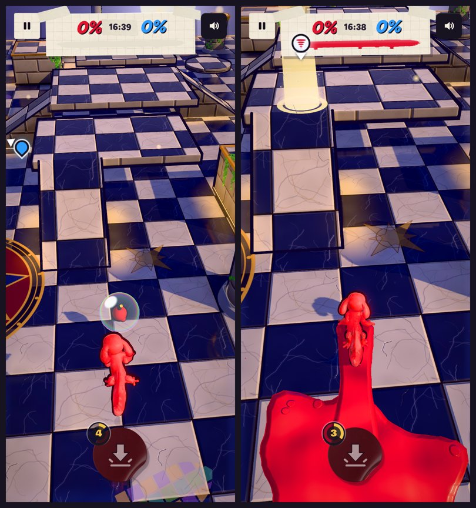

# v310: the orb stays out of the walls, and pick-ups nobody takes are swapped

## 1. The orb never ends up inside a wall

**What was happening.** The orb drifts from spot to spot. It checked its way only at the height of where it was going. Heading for the top of a block taller than it can float up (2.2), it slid in at floor height and stayed inside, out of reach. That's the orb in the Sludge Sewer crate.

**Measured on every stage** (8 stages, 8 layouts each):

- **Floor to the top of a tall block:**
  - **Before:** of 7,817 such moves the old check allowed, 6,475 ended inside the block.
  - **Now:** the orb only takes the 719 it can actually follow, and none of them end inside.
- **A minute of drifting from a spawn spot** (384 runs):
  - **Before:** 224 runs passed through a block, and 3 were stuck inside for over a second.
  - **Now:** 7 runs touched a block corner for a moment while climbing, and none were stuck.
- **Taking it:** set down next to it, the player draws it in and takes it, 5 times out of 5.

**What changed:**

- **Drifting:** the orb only heads somewhere it can follow, step by step. Every step is on a surface it can float up onto, never into a wall and never over a hole.
- **Climbing:** it rises onto a block a little before the edge, instead of sliding through the corner.
- **Being pulled in:** the pull stops at a wall, so you have to come round it. Only a player with an open way to the orb pulls it.
- **Spawning:** it only comes up on open ground.
- **Safety net:** if it ever does end up inside something, it pops out moments later at the nearest open spot, with a sparkle.

## 2. A pick-up nobody takes is swapped for something else

- **When:** after 15 seconds untaken (it used to wait 25, then just vanish).
- **What happens:** it pops, and a moment later something else comes up, always a different kind. The usual marker shows where: a beam of light and a closing ring.
- **Where:** where whoever has waited longest for a pick-up can get to it (or where the old one was).
- **Next time:** the kind nobody took is also less likely to come up.
- **Tested:** four in a row, left untaken, were swapped each time:
  - Boomerang, then Roller;
  - Roller, then Paint Trap;
  - Paint Trap, then Boomerang;
  - Boomerang, then Turret.
- **Not in the first lesson**, which keeps its own script, or online, where the server decides the pick-ups.
