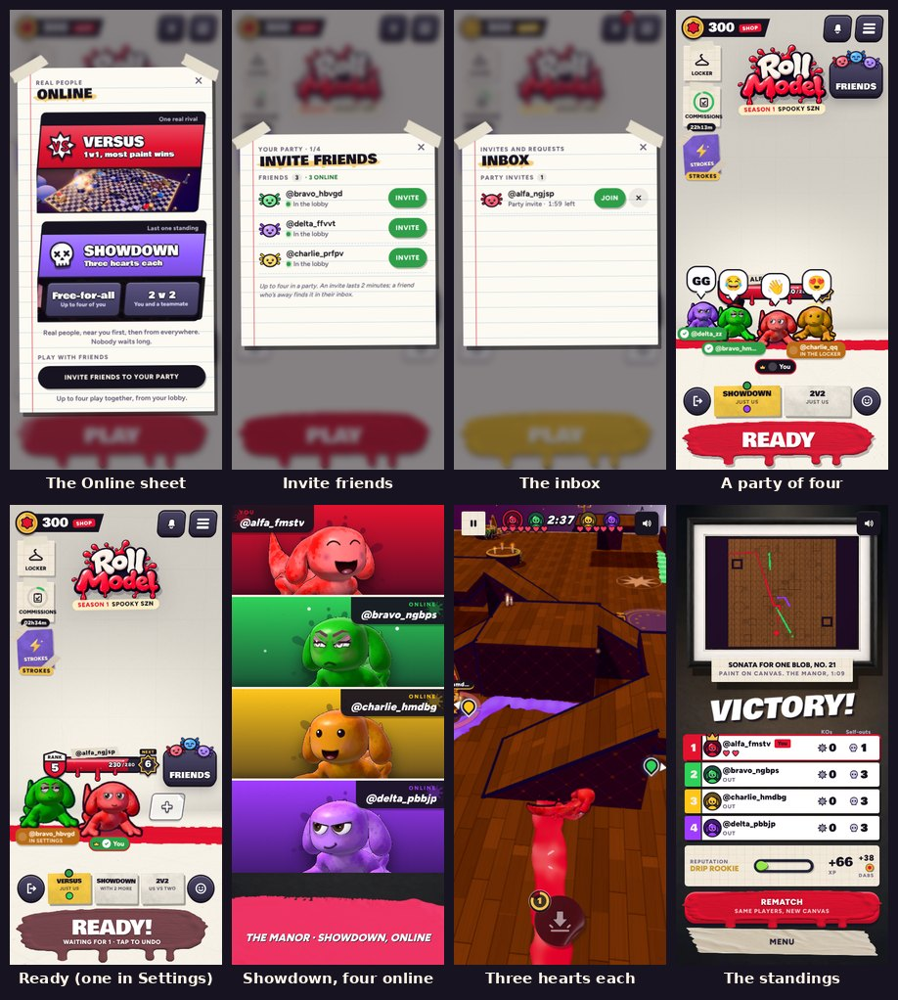
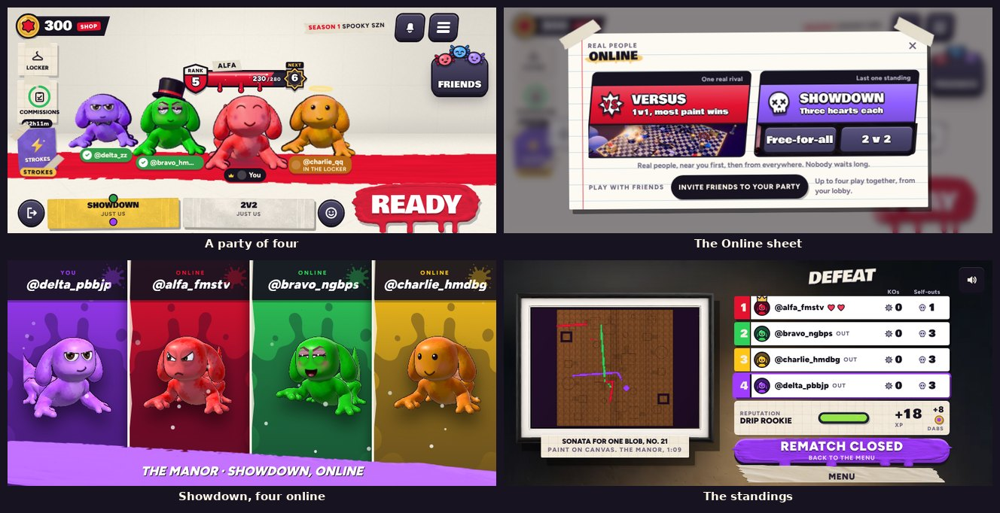

# v312: Parties, Showdown online, and matchmaking that looks near you first

No more room codes. Playing online is either matchmaking with people you don't know, or a party: friends you invite
into your lobby. Up to four play together, in Versus or in Showdown (everyone for themselves, or two against two). As
since v311, every person goes by their handle (@ and their username, in small letters): on the name plates, invites, the
inbox, the versus card, the hearts and the banners. How the game server works is in `docs/multiplayer.md`; the database
is in `supabase/README.md`.

## Playing online

- **The Online sheet** (Play online on Choose Event) offers the modes up front, as Choose Event shows its events:
  **Versus** (1v1, most paint wins) and **Showdown** with its two ways to play, **Free-for-all** (up to four) and
  **2 v 2** (you and a teammate). Tap one to find players. A mode the game server doesn't offer yet is greyed and
  marked Coming next.
- **Finding players** looks near you first, then a little further, then everywhere, and widens the skill range as it
  goes: anyone at all after 12 seconds. "Finding players… 0:07" with Cancel; closing the sheet keeps your place (a chip
  at the top of the lobby opens it again).
- **Nobody about after 30 seconds:** Play the CPU (in the same mode) or keep looking. The game never pretends a CPU is a
  person.

## Parties

- **The + spots.** In the lobby there's a + to your left and a + to your right. Tap one to invite a friend (online
  friends first). Once both sides have someone (or an invite on the way), a third + appears. A friend who joins stands
  in that spot as their own character: their paint, eyes and wearables, with a name plate under them.
- **Invites** come from a + or from Invite on a friend in Friends. A friend in the game gets it at once: a card at the top
  of the lobby (Join or Not now) and a ring of the bell. A friend who isn't in the game finds it in their inbox if they
  open the game within the 2 minutes it lasts. Only friends can invite each other, and blocks are honoured.
- **The inbox** is the bell by the menu button, with a count: party invites (Join, or the cross to decline, with the
  time left) and friend requests (Accept or decline).
- **In a party** the foot of the lobby is the party's: Leave (the door), the mode vote, reactions, and the big button
  is Ready.
  - **The vote:** cards for the modes that fit the party (two: Versus, Showdown or 2v2; three: Showdown; four:
    Showdown or 2v2), each showing who voted for it. The most votes win; the leader (the crown) breaks a tie.
  - **Ready:** when everyone is ready the party has a moment to back out ("Starting… tap to stop"), then plays: two in
    Versus play each other; four play a Showdown or a 2v2 of their own; otherwise matchmaking fills the rest, and a
    party of two in 2v2 is one team. Nobody needs to wait for the leader: the same button readies everyone.
  - **Busy un-readies you.** Opening the locker, the shop, Strokes or Settings, or a new look, un-readies you, and your
    plate tells the others where you are, so a match never starts while someone is changing.
  - **Reactions:** eight emotes, over your character for about two seconds on everyone's screen.
  - **The leader** taps a member's plate to remove them. Leave takes you out; the lead passes to whoever has been in
    the party longest.
- **The connection** stays open in the lobby while you have an account, so invites arrive at once, with a heartbeat every
  20 seconds while nothing happens. It closes when the app goes to the background; the party keeps your place for a
  minute.

## Showdown online

- Three hearts each, the canvas closing in at 60 and 120 seconds, the last one standing wins, as against the CPU. The
  hearts across the top show everyone's.
- In 2v2 your teammate wears your team's colour (your two colours mixed), and so does the other pair.
- Out of hearts, you watch someone still in it, or Leave (your place stays where you went out).
- The last knock-out plays out before the standings come up, as against the CPU.
- A Showdown starts with three if a fourth hasn't turned up after 20 seconds.
- A phone the game server takes out (away too long) is out of the match on its own screen too. If that happens before the
  match has begun on it (still on the versus card), it goes back to the lobby with "Away too long"; the others play on.

## Notifications while the game is closed

Not yet: that needs Apple's push service (see "Decisions needed" in `docs/multiplayer.md`). Until then an invite reaches
a game that is open, or one opened within the invite's 2 minutes.
