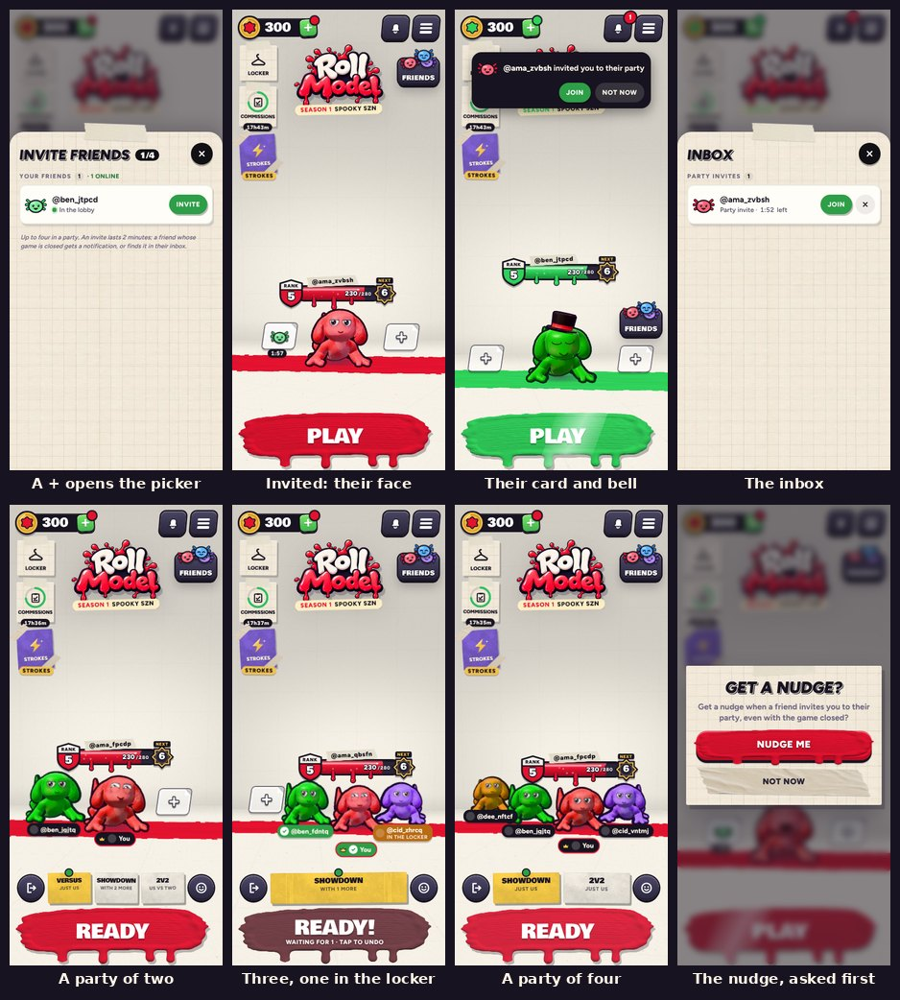
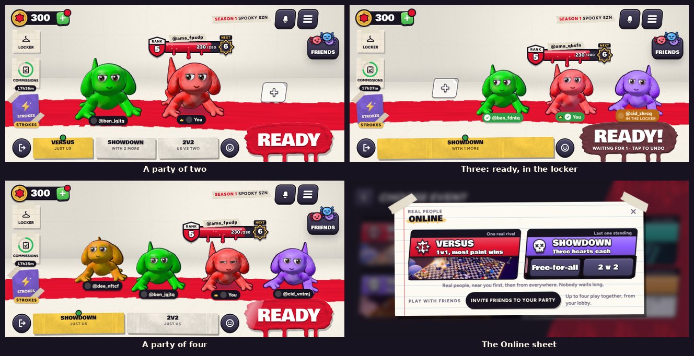

# v391: parties, and invites that reach a closed game





Play with your friends from the lobby. The party work made around v312 (`docs/party-v312.md`) is now in the game, on
today's lobby and Friends page.

## In the game

- **The + spots.** Tap a + beside you: your friends come up, online ones first. Tap one to invite them. Their face
  shows in that spot with the 2 minutes they have to answer. Once both sides hold someone, a third + appears out on the
  left, so three friends can come: a party of four.
- **Your friend's phone** rings: a card at the top of the lobby (**Join** or **Not now**), a count on the new bell by
  the menu button, and a two-note chime. The bell is the inbox: party invites and friend requests.
- **With the game closed,** your friend's iPhone gets a notification ("@you invited you to their party. Tap to
  join!"). Tapping it opens the game on that invite, with its card up until they answer. The first time you invite
  someone or join a party, the game asks in its own card whether you'd like these nudges; only a yes brings up the
  iPhone's own question.
- **Join** and they stand in that spot as their own character (their paint, eyes, wearables and skin) with a name
  plate: a crown for the leader, a tick when ready, and where they are if they're busy ("In the locker"). You see your
  whole party in the lobby, upright and sideways.
- **In a party** the foot of the lobby is the party's: Leave (the door), what the party is waiting on, reactions, and
  the big button.
  - **The host picks the event (v392; the mode vote of v391 is gone):** the host's Play opens Choose Event with only
    the modes that fit the party. Two: Versus (just you two), Showdown (with two more found) or Showdown 2v2.
    Three: Showdown, with one more found. Four: Showdown or Showdown 2v2, just you. The others' button is Ready, and
    they wait for the host's pick ("@host picks the event"). Picking readies the host up; with everyone ready it starts.
  - **v394:** the host's events come in two groups, With players online and Just your party, and each card shows its
    line-up (your face ringed, your friends, a ? for each player to be found, vs between the sides). Two friends:
    Showdown 2v2 as a team against a team found online, Versus 3-way with one more, Showdown with two more, or Versus
    between the two of you. Three: a 3-way of your own, or a Showdown with one more. Four: Showdown or 2v2.
  - **Ready:** when everyone is, a moment to back out, then the match. Opening the locker, the shop, Strokes or
    Settings, or a new look, un-readies you.
  - **The leader** taps a friend's plate to remove them. After a match you're all back in the lobby together.
- **Friends:** each friend has **Invite** where Duel was (or In party, Invited). Duel and room codes are gone.
- **Locked until Play online opens** (rank 2, and the Strokes page seen), as playing with friends was.

## Before it's live (in this order)

1. **The database.** Supabase > SQL Editor > New query: paste all of `supabase/migrations/20261020000000_parties.sql`
   and press **Run** (safe to run again). Until then the + spots say party invites need a database update.
2. **The game server.** The server on Fly doesn't know parties yet. Deploy this one: `cd server && fly deploy`. Until
   then the + spots say parties come with the next game server update.
3. **The notifications' key** (below). Until it's set, invites reach games that are open, as before.
4. **The app.** The iPhone project now has Push Notifications switched on (`ios/RollModel/README.md`); send a new
   build to TestFlight as usual.

## Setting up the notifications (once)

The game server sends each notification to Apple with a key from your Apple developer account. The key is a secret:
it goes only into Fly's secrets, never into a file, a message or the repository.

1. **Make the key.** At developer.apple.com, open **Certificates, Identifiers & Profiles > Keys** and click **+**.
   Name it (for example "Roll Model push"), tick **Apple Push Notifications service (APNs)**, click **Configure** and
   choose **Sandbox & Production**, then **Continue** and **Register**. **Download** the `.p8` file (Apple lets you
   download it once only) and note the **Key ID** shown with it.
2. **Your Team ID** is under **Membership details** in your developer account (10 characters).
3. **The app's ID** (`studio.primeshots.rollmodel`): in **Identifiers**, open it and check that **Push
   Notifications** is ticked. Xcode ticks it itself when it next signs the app; tick it here if it didn't.
4. **Give the key to the game server.** In Terminal, in the repository's `server` folder (put in your Key ID, Team ID
   and the path of the file you downloaded):

   ```
   fly secrets set -a rollmodel-game \
     APNS_KEY_ID=ABC123DEFG \
     APNS_TEAM_ID=XYZ987WVUT \
     APNS_BUNDLE_ID=studio.primeshots.rollmodel \
     APNS_PRODUCTION=1 \
     APNS_KEY_P8="$(cat ~/Downloads/AuthKey_ABC123DEFG.p8)"
   ```

   Setting secrets restarts the server (a match being played is called off, with no rating change). Then you can
   delete the downloaded file or keep it somewhere safe.
5. **Check it:** `fly logs -a rollmodel-game` shows `push: notifications on` when the server starts. Without the key it
   says `push: no APNs key set` once.

`APNS_PRODUCTION=1` is for TestFlight and the App Store. An app run from Xcode says its token is for Apple's sandbox,
and the server sends that one to the sandbox either way.

## How it works

- The iPhone app registers for notifications only once the player has said yes to them, and hands its device token
  to the game. The game keeps it with the player's account in Supabase (`push_tokens`, through `rm_push_token`: only the
  player writes theirs; logging out takes it back).
- An invite is made in Supabase as before (`rm_invite`: friends only, blocks honoured, 2 minutes). The game tells the
  game server, with the invite's id and the inviter's own sign-in token. If the friend's game isn't connected, the
  server asks Supabase, as the inviter, for that one invite's notification (`rm_invite_push`: once per invite, only
  while it's open, only between friends) and posts it to Apple (`server/src/push.js`). More in `docs/multiplayer.md`.

## Tested

- **Game server:** all its tests (`npm test` in `server/`), with new ones for the notifications: a made-up key signs the
  provider token, a stand-in for Apple's service checks it and the headers, a token Apple says is gone, an expired
  provider token made again, Supabase asked as the inviter, and the server sending only for a friend whose game is
  closed. Nothing reaches Apple or Supabase.
- **Database:** the Supabase tests on a local Postgres (the stub, then every migration in order), with new ones for
  the tokens (only the player's own, one account per phone, five at most, gone with the account) and for
  `rm_invite_push` (only the sender, once, only while open, only between friends).
- **In the browser,** against a local game server and the Supabase stand-in, with throwaway accounts deleted
  afterwards:
  - two phones: a + opens the picker, tapping a friend invites them, their face and time in the spot, the card, bell
    and chime on the friend's phone, the inbox, Join, the friend standing in the lobby in their hat with their plate,
    a reaction, Ready and Settings un-readying, both Ready into a Versus of their own, back to the lobby together,
    Leave (27 checks);
  - four phones: the third + once both sides are taken, a party of four with four plates, the picker full, the vote,
    Ready into a Showdown of their own (three hearts each, by handle, to the standings), back to the lobby, the leader
    removing one, another leaving (21 checks); the lobby upright (390x844) and sideways (844x390) with two, three and
    four;
  - notifications with the app's bridge stubbed and a game server with a made-up key against a stand-in for Apple:
    the nudge asked first in the game's card, the token kept with the account, an invite to a closed game sent once
    with the inviter's handle, the tapped invite's card held until answered, Join from it, the token taken back on
    log out (14 checks);
  - on your own, offline: the first lesson played through by the scripted player (every step done, then Basics
    Complete, the new items and the shop, the same as on v390), and a match against the CPU from Play, upright and
    sideways (22 checks). No page errors anywhere.
- **Not tested here:** a real iPhone, Xcode, and Apple's real push service.
