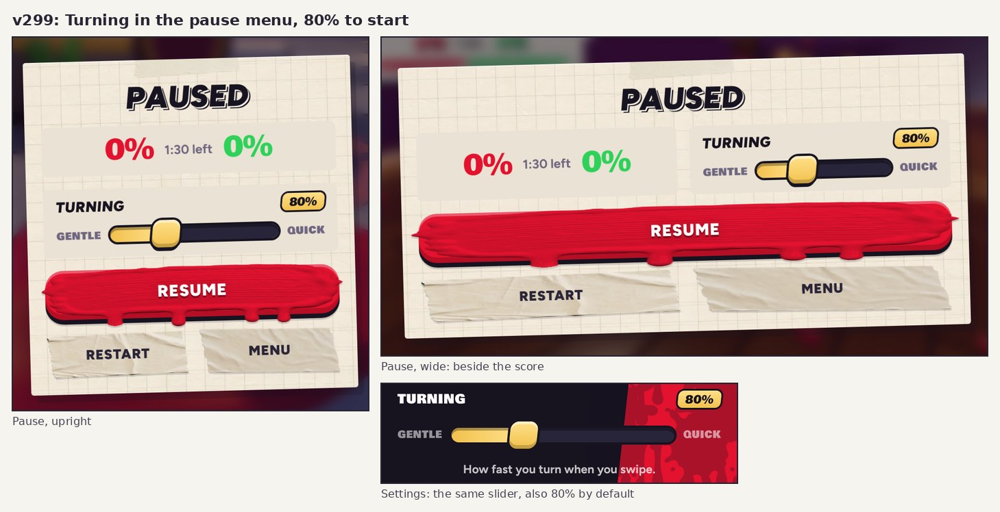

# v299: Turning in the pause menu, and 80% to start

## Turning in the pause menu

- When you pause a match, a Turning strip shows under the score. It's the same slider as in Settings: Gentle to Quick, 50% to 150%
  in steps of 5, with the gold knob and the gold value tag. It sits on the paper card.
- A change takes effect as soon as you resume. Settings and the pause menu always show the same value: moving either one moves
  both, and the value is saved.
- In landscape the card is wider and the strip sits beside the score, so the card is no taller than before. It's 313 points tall on
  a phone held sideways, which has room for 343 to 358.
- It's there in every match, the lesson included (where the pause menu says Skip tutorial).
- With a keyboard:
  - The arrow keys move the slider while it has focus.
  - Escape or P still resumes.
  - In Settings, Escape now closes the page even while the slider has focus.

## 80% to start

- The default is now 80% (it was 100%), so new players turn 20% slower than before.
- Anyone who hasn't moved the slider gets 80%. A value someone picked themselves stays as it was.

## Checked

| Screen | Card size (points) | Fits without scrolling |
|---|---|---|
| 390 x 844 upright | 367 x 375 | yes |
| 844 x 390 wide | 628 x 313 | yes |
| 375 x 667 upright (the lesson) | 352 x 374 | yes |
| 667 x 375 wide | 628 x 313 | yes |

- A touch drag on the pause slider moves it, and Settings shows the same value. It's saved and applies after Resume. Tested to 140%,
  145% and 50%.
- With the slider focused:
  - Escape and P resume.
  - The arrow keys change the value without steering or resuming.
- In Settings, the arrow keys move the slider and Escape closes the page.
- With no saved value, Settings and the pause menu both show 80%.
- The release boots clean.
