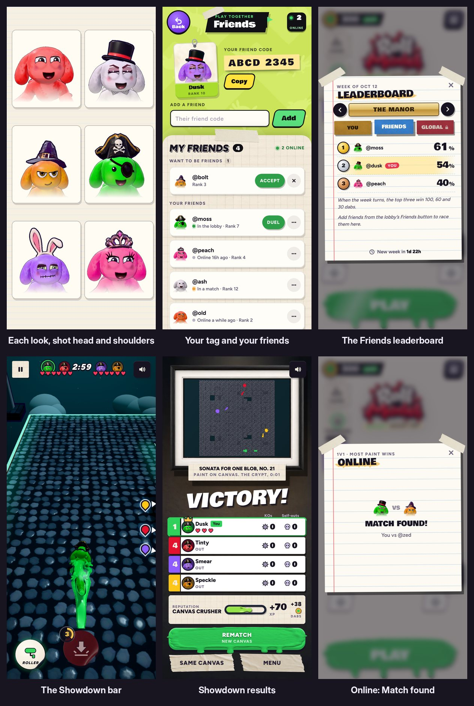

# v331: real portraits in place of the drawn faces

Wherever the game showed a little drawn axolotl face for a character, it now shows that character as it really looks: its paint, its eyes and what it wears, photographed head and shoulders.

## The shot
- **A long lens:** an 85 mm lens's narrow view (16 degrees), from far enough back that nothing looks stretched the way a wide lens makes it.
- **Head and shoulders:** from the top of the head (or the hat) down to the top of the torso, which fades out at the bottom. The head fills the frame.
- **The pose:** the body turned a little, the face and eyes toward you, a smile, no blink.
- **The colour:** lit about like the lobby and toned the game's own way, so each paint looks the way it does on the character.
- **Smooth edges:** drawn at twice the size and scaled down.

## Where they show
- **The Friends page:**
  - Your tag: the photo fills the card.
  - Your friends, requests and the people you're waiting on.
  - The two faces on the empty page.
- **The Friends leaderboard** on the Time trial board.
- **Online:** Match found, the room list and duel invites.
- **The lobby:** your name tag and the three faces on the Friends button.
- **The locker:** the My Locker tab.
- **After a match:** the rows on the victory screen and the Showdown results board.
- **In a Showdown:** the bar of faces over the hearts.

## How they're made
- **One stand-in character,** made the same way as a CPU rival, in a small studio scene of its own. Each look is dressed, posed and shot once, then kept for the session.
- **Never mid-match:** a match's portraits are made while its stage is shown, before Go.
- **While one is being made,** a soft circle holds its place and the portrait fades in, usually within a fraction of a second.
- **If portraits can't be made at all,** the drawn faces stay.

## Friends see what you wear
- **Your look on the server** now carries what you wear, as the online look already did, so friends see your hats and things on your portrait.
- **Friends on an older version** show their paint and eyes until they open the new one.
- **The note on the Friends page** now says friends see your look, not just your paint colour.
- **A look from the server** is checked against the game's own paints, eyes and items, so it can't put anything odd on the page.

## Tested
In the preview build, on a 390px-wide phone and sideways, 43 checks, all passing:
- **The lobby:** every portrait made, none left waiting; the Friends button's three; your name tag in your look.
- **Your look for the server** carries what you wear and stays well under the size limit.
- **The Friends page:**
  - Your tag, friends, requests and waiting-on rows are all portraits.
  - A friend's pirate hat, patch and gold eyes come through.
  - An old Orange friend shows orange, and things the game doesn't know are dropped.
  - A look from the server can't put markup on the page.
- **The locker's tab** shows you, and a new paint makes a new portrait.
- **The Friends leaderboard** and **online Match found** show portraits.
- **A 3-way match:** its portraits are asked for at the start, none are made mid-match, and the victory screen's rows are portraits.
- **A Showdown:** all four portraits are on the bar before Go, and on the results board after.
- **No page errors.**
- **Earlier suites:**
  - The v328 tap checks (26) all pass.
  - The v327 locker checks show only the same four old-flow failures as in v330, nothing new.
  - The v330 eyes and gift checks still pass.
