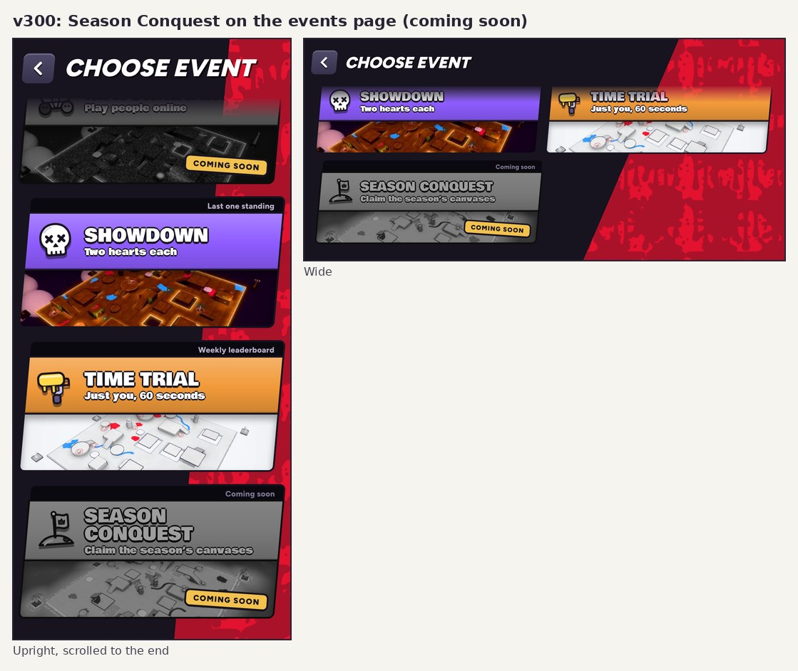

# v300: no announcer on the results, a long hold always lets go, Season Conquest coming soon

## No voice on the results

- The announcer no longer says "Victory!" after a win or "Defeat" after a loss.
- The same goes for "Draw", and for "New best" and "Time" in Time trial.
- The sting, the music, the splash and the character's own little noises are unchanged.

## A long hold always lets go

Holding still brakes you, as before. After a hold of about 3 seconds or more, the character sometimes stayed stopped after you let
go. You had to tap, swipe or fling to get it moving again.

- **Most likely cause:** on iPhone a long press can swallow the finger-up event. The game then thought you were still holding the
  brake.
  - That also explains why a tap, swipe or fling fixed it: a new touch can reuse the same finger ID, so it closed the old hold.
- **Fix:** the touch-end events always arrive, so when the last finger lifts and the brake is still on, the game lets go then. A
  finger-up that lands on something other than the play area also counts now.
- **Checked:**
  - With the finger-up swallowed on purpose, v299 stayed stopped (speed 0, still braking). v300 is back at full speed within 0.4 s.
  - A tap still jumps.
  - A normal hold still lets go as before.

## Season Conquest

- A faded card at the end of the events page, with the Coming soon tag, like Matchmaking.
- It reads "Season Conquest: Claim the season's canvases" and has a flag-on-a-hill icon.
- Tapping it says "Season Conquest is coming soon".
