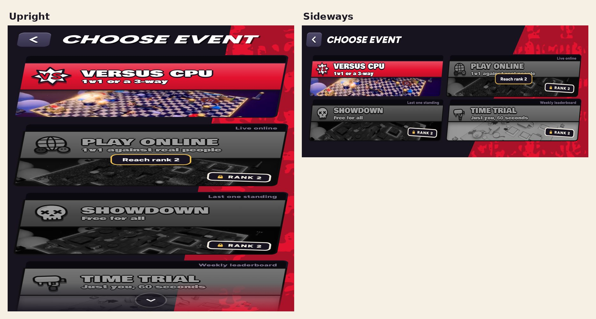

# v360: Play online's lock says "Reach rank 2"

Tapping the locked Play online card under rank 2 now says just **"Reach rank 2"** (it said "Reach rank 2, then open
Strokes"). The card's label for screen readers says the same.

At rank 2, before you've opened Strokes, it still says "Open Strokes in the lobby to unlock it". Once Strokes has been
seen, Play online is open as before.

## Tested

A probe (7 checks, all passed): the line at rank 1 upright and sideways, the screen reader label, the rank 2 line
before Strokes, the open card, and no page errors.
