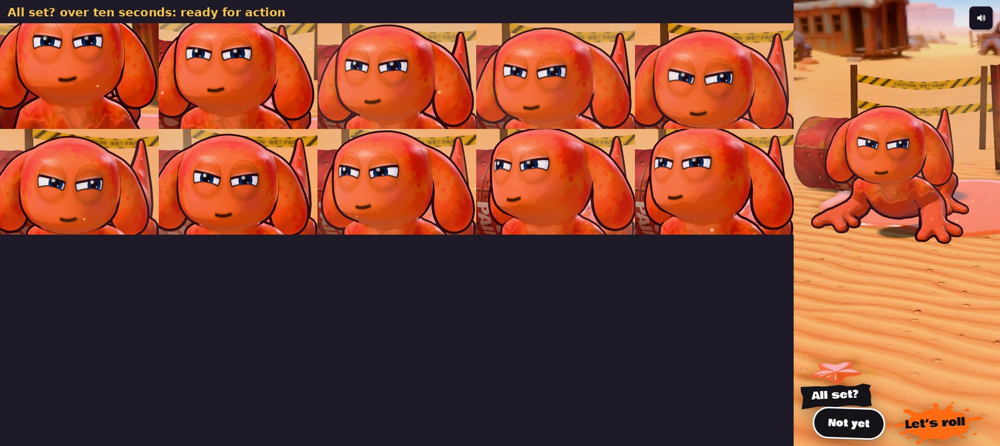

# "All set?" ready for action (v280)

On the first launch's "All set?" card the character used to look happy: cheeks up, blushing, a big open smile. Now it looks
ready for action. Built in `tools/v280_ready.py`, as a patch over the intro (`tools/v257_intro.js` is untouched).

- **A new face, `ready`:** the determined squint over the firm flat mouth from v279, the pupils a touch smaller. It's in the
  character's own expression table, so the rest of the game can use it too. With the Aggressive eyes it's their heavy lid pulled a
  little lower.
- **On the card:** `ready` is the character's face while "All set?" is up. Its little moves there (the perk, a look round, a tilt,
  a proud lift) show `ready` or a confident smirk instead of happy, glee or the cute curious face.
- **Not yet** goes back to the usual friendly face for the picks. **Let's roll** keeps it ready for the launch.
