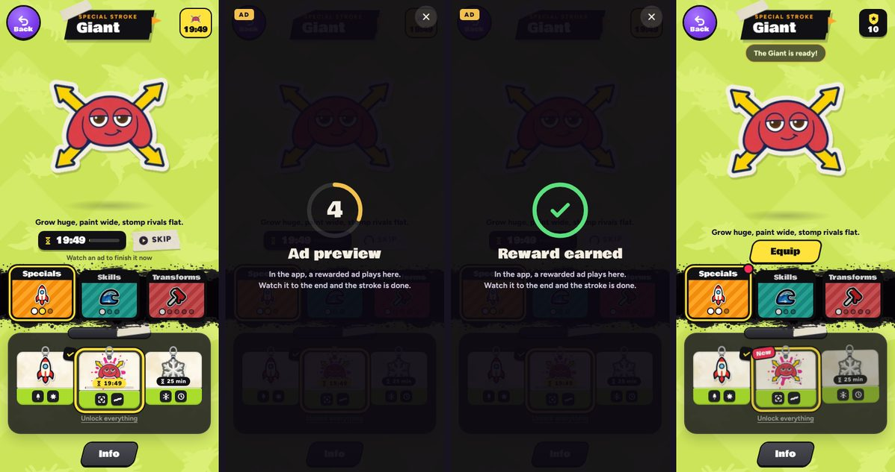

# v321: a rewarded ad speeds up crafting

On the Strokes page, **Skip** on a stroke being crafted now plays a rewarded ad (Google AdMob) in the iPhone app. Once the ad has been watched, the craft finishes with its usual fanfare and "The Giant is ready!".

## How it plays
- **The button says so.** Skip has a play mark on it, and under it the line "Watch an ad to finish it now". While the ad gets ready, the mark spins.
- **Watched to the end:** the craft is done. It's saved the moment the ad reports the reward, so it's kept even if the app closes mid-ad. It's shown off when the ad closes.
- **Closed early:** nothing is earned, and the craft carries on: "Watch to the end to finish it".
- **No ad to show, or offline:** the craft carries on. The game says "No ad to show right now. Try again soon" or "You're offline: connect to watch the ad".
- **The lesson's Skip stays free.** In the Strokes lesson, Ol' Bloop's "this one's on me" Skip has no ad and no play mark. An app built without the ad SDK also keeps Skip free.
- **Sound:** the game's sound is off while the ad plays. It starts afresh when the ad closes, the same way it does after a phone call.
- **Ready ahead:** when a stroke goes on the bench, or the Strokes page opens with one there, the app loads an ad in the background. Usually it plays the moment Skip is tapped.

## Longer and playable ads
The player chose to watch, so the ad unit can allow more than a normal ad. Both are AdMob settings, not code:
- **Playable (interactive) ads** are on by default in a rewarded ad unit (Advanced settings, Ad type).
- **High-engagement ads** (App settings, on by default) let rewarded ads run up to 60 seconds before they can be skipped (30 with it off), with up to three steps to close.

## Who sees what
- **Every ad** is capped at the Parental Guidance content rating.
- **A player who said they're under 13** at the account form (and hasn't made an account since) gets Google's child treatment: child-safe ads only, none personalised, and no consent message. An ad loaded or still loading from before is dropped, not shown.
- **The EEA, the UK and Switzerland:** Google's consent message (set up in AdMob under Privacy & messaging) shows the first time a player there asks for an ad, before it plays. If Google says the player needs it, the Privacy Policy page gets an **Ad privacy choices** button.
- **No tracking prompt:** the app doesn't ask to track players, so the advertising identifier isn't used.
- **The Privacy Policy** in Settings has a new Ads section. It no longer says the game shows no ads.

## In a browser
A browser has no ad SDK, so the preview build shows a five-second stand-in where the ad goes, marked "Ad preview". It works the same way: watched to the end, the stroke is done; closed early, nothing is earned.

## The app side
`ios/RollModel/RollModel/AdsBridge.swift` uses Google Mobile Ads SDK 13 and the User Messaging Platform 3. Xcode adds both as Swift packages the first time it opens the project.
- **From the game** ("ads" messages): who's playing, when to have an ad ready, a request to show one, and the privacy choices button.
- **Back to the game** (a "nativead" event): open, reward, close, fail and state.
- **IDs:** Info.plist holds Roll Model's AdMob app ID and its rewarded ad unit ("Craft skip"): GADApplicationIdentifier and RollModelRewardedAdUnitID. A debug build run from Xcode always uses Google's test ad unit instead.
- **SKAdNetwork:** Info.plist lists the IDs for Google and the 49 third-party buyers AdMob names.
- The steps for AdMob, Xcode and App Store Connect are in `ios/RollModel/README.md`.

## Tested
In the preview build, upright and sideways, 19 checks, all passing:
- **In a browser:** the stand-in plays and the Giant is crafted. Closing it early leaves the craft on the bench. The game's sound goes quiet and comes back.
- **The app's side**, with stand-in answers from the app:
  - The game tells the app who's playing and readies an ad for the bench.
  - Skip spins while the ad gets ready.
  - A reward mid-ad saves the craft as done but holds the reveal until the ad closes.
  - On close, the Giant is crafted with its toast. The sound is off for the ad and back afterwards.
  - "No ad", "offline" and "closed early" each leave the craft on the bench with the right message.
  - The Ad privacy choices button appears when the app says it's needed, and opens Google's form.
- **The lesson:** plain Skip with no line, and the Giant is done at once with no ad asked for.

No page errors in any run. The Swift couldn't be built here (no Xcode on this machine). A second check went through it line by line against Google's current docs and the package listings, and found nothing that would stop the build. The first build in Xcode is its real test.
