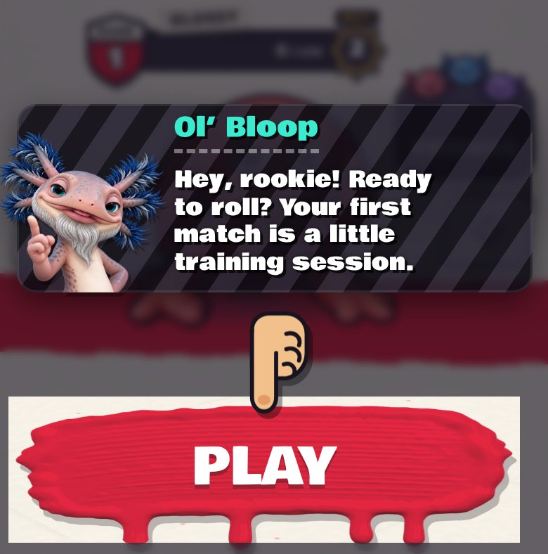

# Ol' Bloop's first line, shorter (v289)

Built in `tools/v289_rookie_line.py`.

- Ol' Bloop's first line in the lobby is now "Hey, rookie! Ready to roll? Your first match is a little training session."
- "Tap Play and show me what you've got!" is gone. The finger still points at Play.
