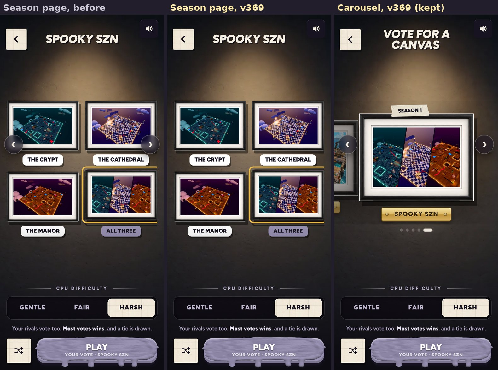

# v369: no carousel arrows on the season's page

## What was wrong

- The canvas carousel's round arrows (previous and next) stayed on screen over the season's page (Spooky SZN: The Crypt, The
  Cathedral, The Manor, All three), sitting on the corners of the top two pictures.
- There they still worked the carousel hidden behind the page. With All three picked, the left arrow quietly picked the canvas before
  the season (Fishing Raft), then the one before that, so nothing on the page showed as picked any more; the right arrow did nothing.
  The arrow keys did the same.

## What it does now

- The season's page has no arrows: it shows all its canvases at once and has its own back button. The arrow keys leave the pick alone
  there too.
- The carousel keeps its arrows, and they work as before.

## Tested

- On v368 and v369 side by side, upright on a phone (393 x 852): the arrows show on the carousel, then on opening Spooky SZN, v368
  still shows them and its left arrow and left arrow key change the pick to Fishing Raft and then Sludge Sewer, with nothing on the
  page picked; v369 shows none, and the pick stays All three after the button and the key. Back on the carousel both builds show the
  arrows and the left key steps to Fishing Raft.
- The same on v369 sideways (844 x 390): no arrows on the season's page, the four canvases in one row.
- **The earlier tests** pass on this build: the v352 checks (25 of 25), v351's two (26 of 26, 7 of 7), v355's (27 of 27) and v354's
  (24 of 24), and the dashboard's end-to-end (38 steps) and live tests (13 steps). One v352 check measured the season's canvases
  against the two arrows; it now checks that the canvases are on the screen and centred with no arrows over them.
