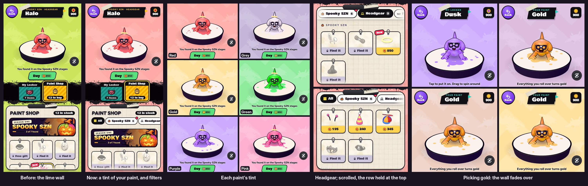

# v333: filters in the Paint Shop, and the locker page's wall in your paint

## 1. Filters in the Paint Shop
- **A row of chips** under the Paint Shop's heading:
  - All
  - Spooky SZN
  - Headgear, Facial, Clothing
  - Eyes, while there are eyes to buy
- **Each kind shows how many things it holds.** A red dot marks a kind with a new find in it.
- **What each one shows:**
  - **All** is the shop as it was.
  - **Spooky SZN** is the season's banner and its finds.
  - **A kind** (Headgear, say) shows everything of that kind. The season's things come first, under a small Spooky SZN heading, then the rest under All year.
- **The row stays at the top of the panel** as you scroll down, on a strip of paper once the cards slide under it.
  - Picking a chip keeps the row where it is, and the new list starts right under it.
  - The row scrolls sideways. Its edge fades while there are more chips past it.
- **Try-on and Buy work the same in any filter.** What you buy stays in the list, marked Yours, until you leave.
- **The page opens on All.** A filter is kept while you switch between My Locker and the Paint Shop.
- **Something picked from outside the panel** shows whatever the filter was. For example, See it in the shop for a new find, or locked eyes in the locker. The filter goes back to All so it's in view.
- **In My Locker,** an empty kind's "The Paint Shop has N" link opens the shop on that kind.
- **The lesson's shop has no row,** because its tips point at the flower and the fangs. The row is there on your next look.

## 2. The wall in your paint
- **The lime wall is now a light tint of your paint,** one per paint. The chevrons and the axolotls are drawn over it in white, as they were over the lime.
  - Red: salmon
  - Grey: lavender grey
  - Gold: butter
  - Green: mint
  - Purple: lilac
  - Pink: bubblegum
- **The pattern is evened out per tint,** so it stands out from each as much as it did from the lime.
- **The window your character stands in** draws its part of the wall the same way, so the window and the wall still meet without a seam.
- **Picking a new paint in My Locker fades the wall over to its tint** in about half a second, as you splash into it. The window fades in step.
- **Smaller things follow the tint:**
  - The light glow behind the line under your character.
  - The soft light bouncing up onto your character from below.
- **The Strokes page and the Friends page keep the lime.**

## Tested
In the preview build, on a 390px-wide phone and sideways:

**The filters (41 checks, upright and sideways, all pass):**
- What each chip holds, and the dot on a new find:
  - All: 19
  - Spooky SZN: 6
  - Headgear: 9
  - Facial: 5
  - Clothing: 4
  - Eyes: 1
- Headgear's season things come first under their heading. Clothing has no headings, since none are seasonal.
- The row is held at the panel's very top while scrolling, with nothing of a card over it. A pick keeps it there.
- Try-on and Buy inside a filter.
- The filter is kept across the two tabs.
- A pick from outside goes back to All.
- Focus stays on the chip when it's picked from the keyboard.
- The page reopens on All.
- The locker's link opens the shop on that kind.
- The lesson's shop has no row, and the row comes in after the lesson.

**The wall:**
- Each paint's tint on opening.
- The fade to a new paint ends on its tint.
- The window's part matches the wall's, at the same spot:
  - In a steady paint: 0.08% of pixels more than 3 levels apart, at the pattern's edges. The Strokes page's lime, as it already shipped, has 0.2% to 0.6%.
  - Halfway through a fade: 0.3%.
- The Strokes page's window still draws its lime picture, unchanged from the build before.

**Earlier suites:**
- The v331 portrait checks pass (43/43).
- The v328 tap checks pass (26/26).
- The v330 eye and gift checks pass (45/45).
  - One full run missed the sideways in-match gift pickup (4 checks), which this change doesn't touch.
  - Two reruns of that part passed, as did the build before this change.
- The v327 locker checks show the same four old-flow failures as before this change, on each screen size, and nothing new.
