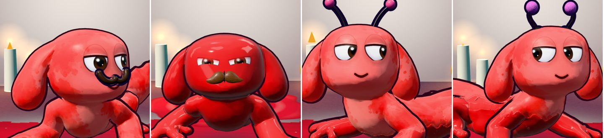

# Paint Shop: prices by matches, and better models (sh01, sh02)

Modules on branch `claude/shop-prices`, applied after the v336 list: `EXTRA=sh01_prices,sh02_wear_models`.

## What a match pays

Dabs are paid at the end of a match (the two `const drops = Math.round(8 + ...` lines):

- Paint modes: 8, plus 0.35 per point of the canvas you painted, plus 30 for a win (12 for a draw), 10 for a new best, 6 in a trio.
- Battle modes: 8, plus 5 per knock-out, plus 30 for a win (12 for a draw), 8 for second place.

A typical win pays about 55 and a typical loss about 20. Winning about half your matches, that's **about 40 dabs a match**. Commissions
(20 each, three a day) and the friends board come on top and aren't counted.

## Prices (sh01)

Matches = new price / 40.

| Item | Old | New | Matches |
|---|---|---|---|
| Flower | 145 | 100 | 2.5 |
| Mustache | 195 | 110 | 2.8 |
| Lashes | 220 | 110 | 2.8 |
| Beanie | 205 | 120 | 3 |
| Bouncy antennae | 195 | 120 | 3 |
| Glasses | 270 | 130 | 3.2 |
| Monocle | 290 | 130 | 3.2 |
| Eye patch | 330 | 140 | 3.5 |
| Skull bow | 835 | 150 | 3.8 |
| Bow tie | 185 | 320 | 8 |
| Pearl necklace | 160 | 330 | 8.2 |
| Fangs | 400 | 330 | 8.2 |
| Scarf | 180 | 340 | 8.5 |
| Arm floaties | 245 | 340 | 8.5 |
| Party hat | 240 | 350 | 8.8 |
| Snorkel mask | 295 | 360 | 9 |
| Propeller cap | 345 | 370 | 9.2 |
| Top hat | 580 | 380 | 9.5 |
| Halo | 850 | 400 | 10 |
| Pirate hat | 695 | 460 | 11.5 |
| Tiara | 475 | 480 | 12 |
| Hero cape | 480 | 520 | 13 |
| Bunny ears | 645 | 540 | 13.5 |
| Hockey mask | 765 | 560 | 14 |
| Witch hat | 1105 | 600 | 15 |

Unchanged: the Zombie eyes (a free gift) and the Sly eyes. What has to be found on a stage first still does. The first lesson still
sets the Flower's and the Fangs' prices while it runs.

## Models (sh02)

Made on Ludo.ai: an image of each piece (image type "3d"), then image to 3D (`POST /assets/3d-model`, the "prop" model, 4 credits
each), with a low face count. `tools/sh_ludo3d.py` runs it; `tools/glb2pack.py` and `tools/sh_nrm.py` pack the GLB with a 256px color
map and its normal map. The GLBs and pack entries are in `models/shop/`.

- **Mustache:** a full handlebar with sculpted hair grooves and curled tips, 2,400 triangles, 70 KB in the page. Same place under the nose.
- **Bouncy antennae:** a smooth curved stalk on a small round base with a fuzzy pink pom-pom, 1,400 triangles each, 60 KB. No coil.
  They still bob, splay and lag behind as before.

## Still basic

From the locker shots, these are built from plain shapes and would gain most from the same treatment: Beanie (a plain dome),
Party hat (a plain cone), Eye patch (a flat disc), Scarf (a tube), Halo (a flat ring), Arm floaties (plain rings), Monocle.

Probe: `tools/shwear.py page.html outdir [ids]` puts each piece on in the locker and shoots it.
