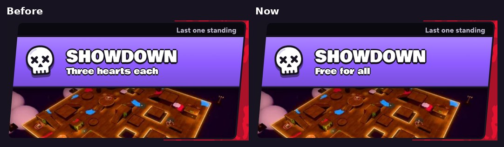

# v345: the Showdown card says "Free for all"

- **On Choose Event, the line under SHOWDOWN now says "Free for all"** in place of "Three hearts each".
- The other cards' lines are unchanged.
- Opening the card still offers Free-for-all and 2 v 2, and the banner at the start of a Showdown still says three hearts each.

## Tested
In the preview build, on a 390px-wide phone and sideways. 4 checks, all pass:
- **The Showdown card says Free for all,** on one line, upright and sideways.
- **The other cards' lines are unchanged:** 1v1 or a 3-way, 1v1 against real people, Just you, 60 seconds, and Conquest's.

The same checks on v344 find "Three hearts each".
