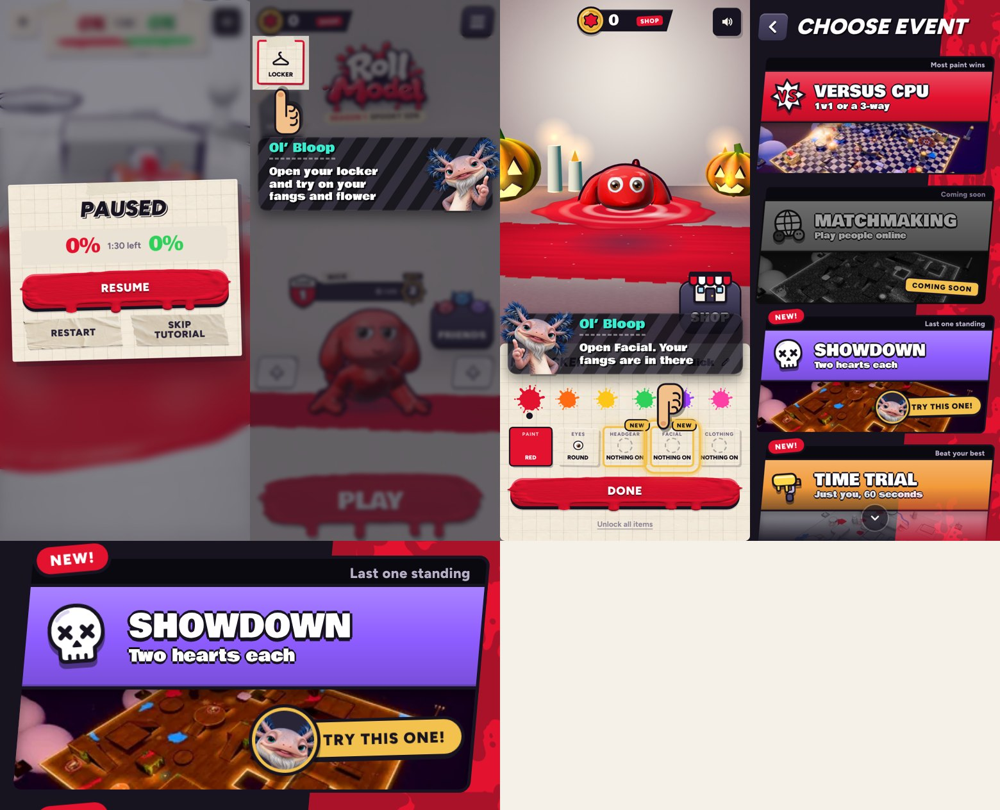

# Skip tutorial, intro puddle sounds, Ol' Bloop's Showdown pick (v283)

Built in `tools/v283_skip_sfx_sd.py`, with the sounds in `game/sfx/i_*.mp3`.

## Skip tutorial

- In the first lesson match, **Pause** offers **Skip tutorial** where it said Menu. The second and third lesson matches keep Menu.
- Skipping ends the lesson match there and goes back to the lobby with what that match would have given you: the **Flower** and the
  **Fangs**. They're already yours, since a skipped match earns no dabs to buy them with.
- Ol' Bloop goes straight on to the locker lesson ("Open your locker and try on your fangs and flower", then Facial for the fangs and
  Headgear for the flower). After that the lesson carries on as before: the canvas vote, then the second match.

## The intro's puddle and shake-off (Ludo)

Four new sounds, picked from 11 Ludo takes by their shape (length, loudness over time, how many hits, how bright or deep):

| Moment | Sound |
| --- | --- |
| The paint puddle bubbles before the eyes come up | two deep gloopy blorps (`i_bubble`) |
| The eyes come up out of the paint | a deep wet gloop with drips falling back (`i_rise`) |
| It hauls itself out of the hole | three squishy, sticky pulls (`i_climb`) |
| It shakes the paint off | a rubbery flap-flap and a splatter of paint (`i_shake`) |

They play alongside the intro's own sounds and are fetched while the barrel rocks, so they're ready in time. If one hasn't loaded
yet, the old sound plays instead.

## Ol' Bloop suggests Showdown

Once the new game modes are open (after the "New game modes!" card), the first time you're on Choose event, **Ol' Bloop's pick** sits
on the Showdown card: his face in a gold ring and a "Try this one!" tag, bobbing gently on the card's picture. It's only a suggestion:
nothing is dimmed or blocked, taps go through it, and every card works as usual. It goes once you leave the page and doesn't come back.
