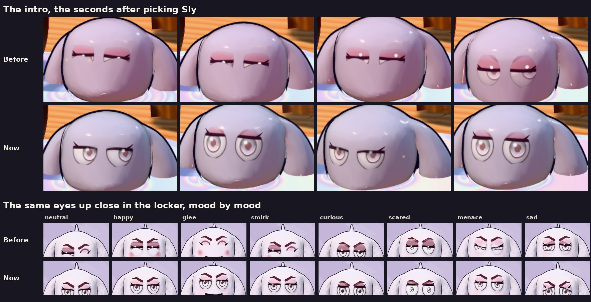

# v336: the Sly eyes show the eye

## What was wrong
- **The Sly eyes' heavy lid sat across the middle of the eye,** with the pupil half under it, whatever the mood.
- **A mood that narrows the eye left a slit under it.** Happy, glee and the smug faces all narrow it.
- **The intro showed this most.** Picking Sly sets off a proud wiggle with a happy face, up close. So for several seconds the eyes were two slits.

## What changed
- **The lid sits higher.** The whole pupil and most of the iris show. The lid still slants down to the outer corner, with its dark lash line and wing.
- **The eye stays open whatever the mood. The mood moves the lid instead,** as the Aggressive eyes already do:
  - A little lower when smug or pleased (happy, glee, smirk, menace).
  - Higher when curious, startled or scared. Scared opens the eyes wide, with the lash line still across the top.
  - Sad, pouting and hurt keep their own eye shapes, with the lid a little higher.
  - Eyes that close (yawn, doze, sneeze, dizzy, bracing) and sleepy keep the game's own faces.
- **It rises a little when the eyes look up.**
- **In the intro, the paint no longer covers the eyes' make-up.** You're still covered in paint there, and the paint used to leave only the eyeballs clear. Now it leaves the whole eye clear from the lash line down, plus the lash line and the wing.
  - The lid's skin above the line stays painted, like the rest of the face.
  - A blink now shows the closed lash line. Before, a blink left a blank face.
- **A blink closes the eye as before.**

## Tested
In the preview build, on a 390px-wide phone:
- **The intro, played through to the eyes card with Sly picked:** 32 shots over 8 seconds.
  - Every open frame shows the whole eye with the lash line and wing.
  - The two blinks show the closed lash line.
- **The locker close-up, mood by mood:** neutral, happy, glee, smirk, curious, scared, menace, doze, sleepy and sad.
  - Every open mood shows the pupil.
  - Doze keeps its closed eyes, with the wings in place.
- **The lobby:** the open eyes with the lid's lash line.
- **The v330 eye and gift checks pass (45/45).**
- **The v331 portrait checks pass (41/43).** The two that differ are the ones v334 changed on purpose: the Friends button's drawn faces.
