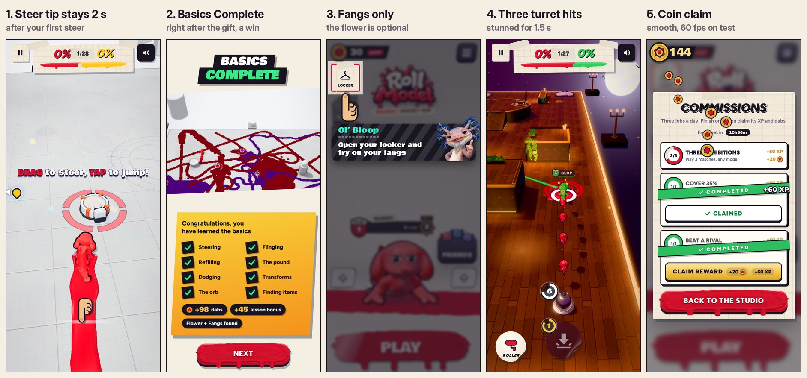

# v304: five small asks

## 1. "DRAG to steer, TAP to jump!" stays up 2 seconds longer

- **Before:** the callout faded the moment you started steering, before there was time to read the "TAP to jump" half.
- **Now:** it stays 2 more seconds (game time) after your first steer, then fades. If the step finishes first, the 2 seconds count from then, and the callout goes with its "Nice!".
- **Measured:** steered at 0 s, the callout was still up at 1.95 s and faded at 2.0 s.
- **Fixed along the way:** the jump half of this step never counted. Since v285 its check sat inside a comment, so only 14 m of crawling ended the step. A steer and a jump end it again.

## 2. No "Now win it!" card: the lesson ends there, on Basics Complete

- **Where it ends:** a beat after the gift step (where the card used to come up), the match is over.
- **What you see:** no "Time!" banner. The lesson's own finish, Basics Complete, comes up 0.8 s later. Then Next leads to the tally and the results, as before.
- **The first match is still a win.** There's no finale to win it in any more, so two things make sure of it:
  - **Through the lesson:** the rival's trail thins out as his score (paint plus the knock-out bonus, as the tally adds them up) comes within four points of yours, and stops about two short of it. He paints his first two points freely, and his tank only spends what his trail lays, so he doesn't run dry because of it.
  - **At the very end:** if his pounds or his rocket still have him level or ahead, a burst of your paint round you puts you in front. These are real splats, so the canvas and the numbers agree.
- **Tested:**
  - **Normal end:** no card, no "Time!", then Basics Complete, the tally, and a win (2% to 1%).
  - **Two full playthroughs** by the scripted player (real touches, every step):
    - wins of 21 to 12 and 19 to 10;
    - the match ended 1.1 s into the last beat both times, then Basics Complete, the tally and Victory.
  - **Rival rigged 6 points ahead before the gift:**
    - his trail stopped (his paint changed by 0.000% over 3 s);
    - at the end the burst put you ahead, 5 to 4;
    - Basics Complete, the tally and Victory followed.

## 3. The flower is optional

- The locker lesson now asks only for the fangs: "Open your locker and try on your fangs", then Facial, then the fangs.
- With the fangs on, it goes straight to "Take a look around, squirt. Express yourself!", and Headgear stays "Nothing on".
- The flower is still found in the lesson and bought in the shop step. It's in Headgear for anyone who wants it.

## 4. Three turret hits in a row stun for 1.5 seconds

- **The stun:** stars over the head, no moving, and the "Stunned!" banner, the same as a roll stun but shorter.
- **What counts as three in a row:**
  - all three from the same turret;
  - none of that turret's shots at you misses in between;
  - no more than half a second between hits.
- **After a stun:** there's the usual 1.5 s when it can't happen again. Hits while stunned, or in that window, don't count toward the next one.
- **Tested in code:**

  | Case | Result |
  |---|---|
  | 2 hits | no stun |
  | a shot at him missed | run reset |
  | 2 more hits | no stun |
  | a 3rd in a row | stunned 1.5 s, "Stunned Smear!" |
  | more hits while stunned | no re-stun |
  | 3 hits in the guard window | no stun |
  | a 0.7 s gap, then 2 hits | no stun |

- **Tested live:** the player's turret on a rival 10 m away. The 3rd hit landed 0.25 s after the 1st, and the rival was stunned for 1.5 s with "Stunned Glop!".
- **Worth knowing:** hits still drain paint while the target is stunned. A rival who stays in a turret's line for the whole stun is usually close to empty when it ends. If that's too strong, the fix is to make hits during a stun drain nothing.
- **Online:** the server doesn't referee turret shots yet. docs/multiplayer.md now lists this rule for when it does.

## 5. The commissions coin claim runs smooth

There were two causes:
- **The blur:** the lobby's 3D view kept drawing every frame under the Commissions window. The window has a full-screen blur, which had to be redone each frame as the lobby moved.
- **Script-driven coins:** the coins were moved by script every frame, so any slow frame made them stutter.

Now:
- **The lobby holds still** under the Commissions window. It's dimmed and blurred there anyway, so you can't tell.
- **The coins fly as compositor animations.** Each coin's whole curve is laid down when you tap Claim, and the browser plays it off the main thread. Only the landings (the count going up, the bump, the clink) run in script.

Measured on the test machine, which draws in software, so it shows the main-thread load rather than a phone's frame rate:

| | v303 | v304 |
|---|---|---|
| Frame time with Commissions open | 317 ms (about 3 fps) | 16.7 ms (60 fps) |
| Frame time during the claim | 250 ms median, 350 ms worst | 16.7 ms median, 33 ms worst |
| Times a coin's position changed in flight (sampled every 50 ms) | 3 | every sample |

Both versions end on the same count (140 + 20 = 160 dabs) with no errors.
