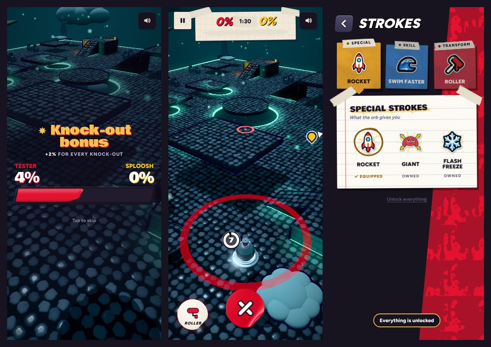

# v309: the crash fix, a quicker launch and ten small asks

## 1. The game crashing and starting over

**What was happening.** iOS closes a web page that holds too much memory. The app then loads the game again from the loading screen, which is the "crash and restart". Two things grew with every match and were never given back:

- **Every canvas played kept its pictures for the rest of the session.** In Graphics mode each stage makes its floor and wall surfaces (colour, relief and gloss), its lighting, and its floor art the first time it's played: 30 to 60 MB on the GPU and about 20 MB of page canvases. They were never let go, and there are eight stages.
- **The refills, hot puddles and pick-ups were only taken off the scene, never disposed.** About 80 meshes were left behind in every match.

**Measured** (the same session played through every stage, in Graphics mode):

| | Before | Now |
|---|---|---|
| GPU pictures, the lobby | 247 MB | 247 MB |
| GPU pictures, after all eight stages | 670 MB, and growing with each new stage | 428 MB at the most, about 400 MB after |
| Page canvases, after all eight stages | 210 MB (84 MB in the lobby) | 117 MB at the most |
| Lighting depth buffers | 64 MB | 28 MB |
| Meshes held, 1 match then 6 matches | 438, then 841 (about 80 more each match) | 359, then 368 |

These were measured in the test browser. A phone's totals differ (the lobby figure includes a shadow map four times the size a phone uses), but the growth is the same, and that's what is gone.

**What changed:**

- Only the stage being played and the one before it keep their pictures. An older one lets them go, and makes them again (as on its first visit, behind the wipe) if it comes round again.
- What leaves the stage is disposed, so a match leaves nothing behind.
- Going to the background, or a memory warning from the phone, lets go of everything not on screen (the other stage's pictures and the songs not playing). A phone is much less likely to close the game while you're away from it.
- The performance readout (tap the version line in Settings five times) has a new line: how many pictures and meshes the GPU holds, and how many stages are kept.

**Also checked:**

- **The GPU going away mid-match.** When iOS takes the GPU from the app and gives it back, the game carries on drawing, with no restart. Tested by dropping the GPU in a match and restoring it a second later: no reload, no errors, still in play.
- **Two matches in a row, then a pick-up and a trim.** The refills (all 8) and the hot puddles are back in the second match. A pick-up spawns and can be taken. Letting go of memory mid-match keeps the stage in play drawn and working, with no errors.

## 2. A quicker launch

- **Before:** the game made every shader a match could ever need (about 130) before the menu showed, behind "Lighting the gallery".
- **Now:** only the ten or so the lobby needs are made at launch. The rest are made in pieces behind Choose Event (which covers the lobby), or under the wipe into the first match if that comes first.
- **Measured** on the slow test machine: from 35 to 65 seconds down to about 12.

## 3. Out of paint, the slingshot rolls you forward

- The pull works as always. Letting go rolls you forward: the dodge roll, a little shorter for a short pull, never faster than a roll.
- The aim ring sits on the ground about where the roll takes you, and the band turns grey.
- If the roll is still cooling down, you get a push off instead, so letting go always moves you.
- A one-time tip says so.

## 4. The knock-out bonus is seen being added

- When the tally reaches the knock-outs, "Knock-out bonus" and "+2% for every knock-out" go up over the bar.
- Each knock-out pops up as a gold star with its +2% over that side's number, flies down into the end of its paint on the bar, and lands with a splat. The number and the bar go up as it lands.
- Each one takes a little longer than before (0.62 s), so it reads.

## 5. The turret is easier to aim

- No range to set: shots go onto a rival in front of you (a wider cone than before, at any distance in reach) or, with nobody there, sweep near to far to paint a strip.
- Turning is gentler: slow for small drags, quicker for big ones.
- A rival near your line pulls the turret round onto them, less the harder you steer away.

## 6. The X on the pound button gets you out of the turret

- While you're in a turret, the pound button shows an X. Tap it and you're out.
- Before, you were stuck in it until its time ran out.

## 7. Reputation titles

Twelve titles, a new one every three ranks:

Fresh Paint, Drip Rookie, Splat Kid, Street Brush, Color Bandit, Ink Outlaw, Canvas Crusher, Neon Menace, Splash Tyrant, Paint Phantom, Chroma Legend, Masterpiece.

(It used to start at "Unknown".)

## 8. The first lesson

- Flattening the rival also finishes the roll-over step.
- After your rocket, the rival comes back from its knock-out and launches its own rocket in about two seconds instead of about ten.

## 9. Showdown: three hearts each

- Was two. Every text that said "two hearts each" now says three.

## 10. Mines knock you out

- The Paint Trap knocks out whoever sets it off ("Trapped!"). It used to stun.
- Online, where only the game server decides knock-outs, it still stuns for now.

## 11. Unlock everything, in Strokes

- "Unlock everything" at the foot of the Strokes page, code 1234.
- It unlocks every stroke, every item, and the rank every lock asks for (Strokes, the modes, commissions, each transform). A lesson under way is left alone.
