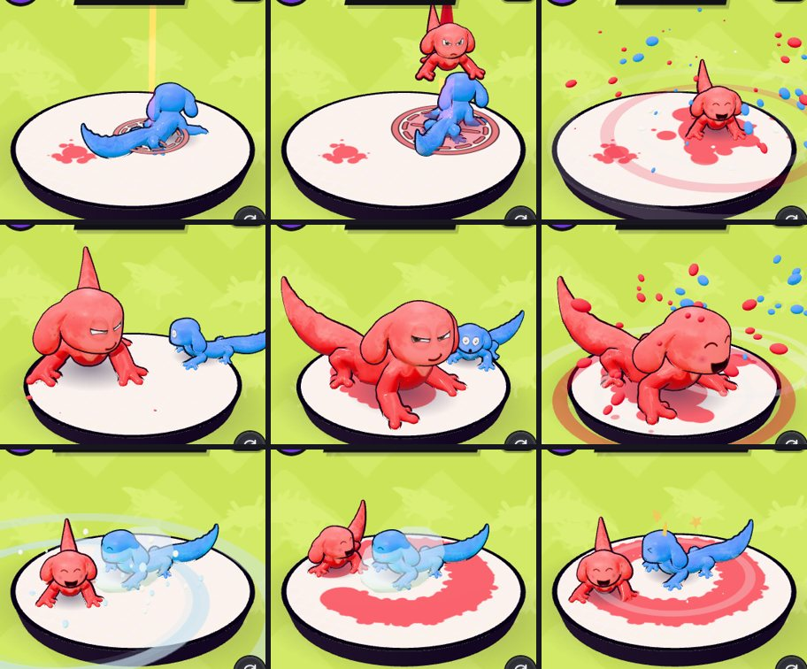

# v322: 3D demos for the Specials

The 3D demo window on the Strokes page (added for Transforms in v313) now plays for the three Specials too. Like the Transforms demo, it loops with your own axolotl against a rival on the paper pad, drawn with the match's own character code.

## What each one shows
- **Rocket:** you blast up off the pad on the paint jet and out of sight. Your target mark slides over the rival, who backs away while the mark follows. Then you dive, and the splash knocks them out. The rocket pack, the mark and its beam are the same pieces a match uses.
- **Giant:** you grow, and the camera eases back to take it in. You crawl toward the camera leaving a wide stripe, while the rival cowers. Then you pound the floor and the splash reaches them. Near the end you flicker, as in a match, and shrink back.
  - The demo's Giant is twice your size, not three times: three times doesn't fit the window. A Giant in a match is unchanged.
- **Flash Freeze:** frost rings wind up, then the flash goes white-blue over the window. The rival is frozen mid-stride in the match's ice shell. You paint a full ring round them, then grin at the camera while they tap at the ice, and they thaw.

The pad shakes with the big landings. With reduced motion on, the flash is softer and the camera doesn't shake.

## On the page
- **Test** (the button by the demo) now works for the Specials too. It plays the demo with that Special's own three lines, each shown while it happens. For example, Flash Freeze shows "A flash over the whole canvas", then "Every rival frozen solid for 5 seconds", then "Paint all you like while they're stuck".
- **Sideways**, the Specials tab now uses the same layout as Transforms: the cards on the left, the demo on the right.
- **Skills** keep their picture, with no demo.
- Switching stroke or tab mid-demo starts the new demo clean: no frozen rival, rocket or giant left over from the last one.

## Tested
In the preview build, upright and sideways:
- The frames above, stepped through moment by moment, with every character kept inside the window.
- 8 checks, all passing:
  - Test shows each Special's three lines in order (one check per Special).
  - Switching away mid-freeze, mid-giant and mid-rocket leaves nothing behind.
  - Skills keep their picture.
  - A match's Giant is still three times the size.
- No page errors.
