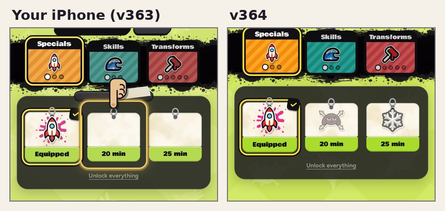

# v364: the Strokes page's cards show their pictures, and the taped bar over them is gone

## The missing pictures

A stroke you haven't crafted yet (the Giant and Flash Freeze, while the Rocket is yours) shows its picture greyed and
faded, so you can see what's still to craft. On your iPhone those cards came up blank.

The grey and the fade were a filter on the picture's frame, and the picture inside has a filter of its own (its drop
shadow). Safari on an iPhone drew none of that: no picture at all. Your crafted Rocket, with no filter on its frame,
showed fine, and so did the Free gift card's eyes in the Paint Shop, which are a drawing with no shadow. The locked
"Find it" cards there were blank for the same reason.

Now the grey and the fade go on the picture itself (and on the splat behind a picked card), so nothing is filtered
twice. That covers:

- strokes still to craft or still locked (Specials, Skills and Transforms),
- the "More soon" card,
- the Paint Shop's locked cards ("Find it", the free gift).

They look the same as before: greyed, faded, the picture showing.

## The taped bar

The dark rounded bar with tape at the top of the cards' sheet (a rail for the cards to hang from) is gone.

## Tested

In the test browser (which drew the old cards too), on the build before and this one:

- Every card on all three tabs: before, the frame was filtered and the picture had its own filter; now the frame has
  none and each picture is greyed, faded and shadowed by itself. They look the same, with the bar gone.
- A picked card that's still to craft (the Giant) keeps its grey splat behind it.
- The earlier tests (the v352, v351, v355 and v354 checks, and the dashboard's end-to-end and live tests) pass on this
  build.

I can't run an iPhone here, so the blank cards are fixed by removing what Safari couldn't draw, not by watching it on a
phone. It's worth a look on yours.
