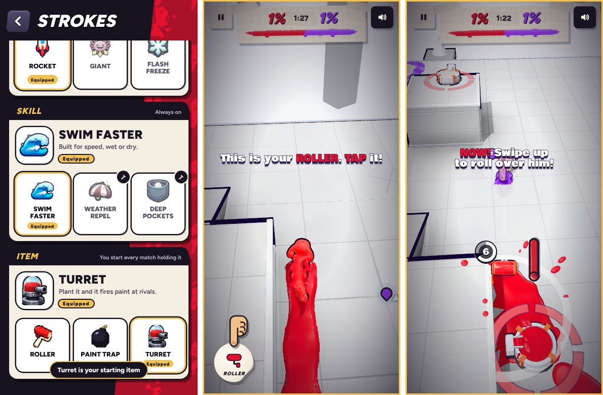

# v270 starting item

## What changed

- **Every match starts with an item in hand.** You get the item picked under Abilities (the Strokes page); it's the Roller until you change it. Each CPU starts with one of the three at random and holds it 2 to 8 seconds before its usual item logic uses it. The lesson's CPU starts with nothing. Items still spawn on the canvas as before. Because everyone is already holding one, the first spawn waits until somebody has used theirs.
- **Abilities has a third row, Item.** It holds the Roller, the Paint Trap and the Turret, all yours from the start, with no crafting. Each tile opens the same card as the strokes, labelled *Item*, with a *Yours* badge and *Equip*. The choice is saved as `store.strokes.item`. The pictures were painted with Ludo.ai in the strokes' style (`tools/assets/item_*_256.webp`). Ol' Bloop's Strokes introduction mentions the item too.
- **The versus card no longer says "Are you ready? Let's roll".** The line also played after the canvas vote, and it's gone from there too. "Go!" at the countdown stays.
- **A one-time hint** shows in your first match outside the lessons: "You start with your roller. Tap its button to use it".

## The lesson (`tools/v270_loadout.py`)

| Step | What happens |
|---|---|
| start | You hold the Roller, but its button is hidden and can't be used (`tut.hideItem`) |
| item | The button pops up and is raised above the slow-motion shade (`.itemBtn.tutup`, z-index 8 over the `.tutslow` vignette's 7). Play slows and the tip "This is your ROLLER. TAP it!" points at the button. No roller is dropped for you to pick up any more |
| rollover | The rival is brought round dead ahead (`tutRivalIn(7, true)`), walks down your line and stops about 3 m out (`tutLine`). When he's 1.5 to 5.5 m straight ahead, with a clear path and level ground 3.5 m past him (`tutRunClear`), play slows to a quarter and "NOW! Swipe up to roll over him!" shows with the swipe finger. The roll is aimed at him (`tut.rAim`). If you miss, he comes round again. The roller lasts until you flatten him or the step times out after 45 s |

Measured in the test build (`_v270_test.html`): from the roller tap to the "NOW" tip takes about 1 to 2 s of game time, and one swipe flattens the rival. The rival also lines up in landscape, with the item button on the right.
