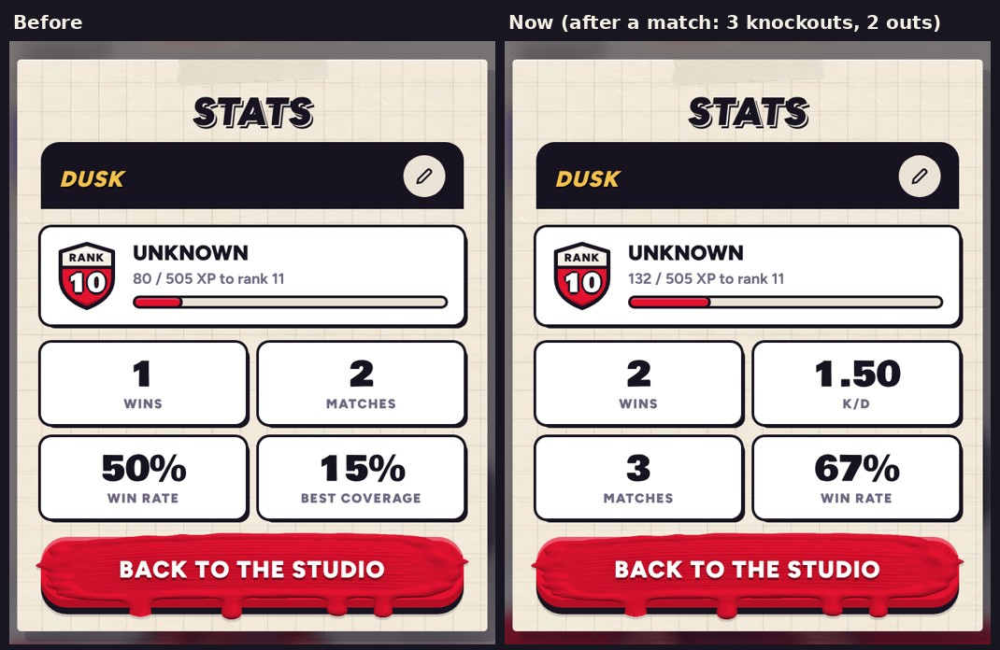

# v342: Stats shows wins, K/D, matches and win rate

- **The Stats card's four tiles are now:**
  - Wins and K/D on top.
  - Matches and win rate under them.
- **Best coverage is gone from the card.** It's still kept for the results' "new best".
- **K/D is your knockouts divided by the times you were knocked out,** whether by a rival or off the edge.
  - It counts every match but Time trial: duels, three-ways, Showdown and online.
  - The game didn't keep these before, so K/D starts counting with this version. Until there's something to show, it shows a dash.
  - With no outs yet, it's your knockouts.

## Tested
In the preview build, on a 390px-wide phone and sideways. 8 checks, all pass:
- **The tiles:** Wins, K/D, Matches, Win rate, and no best coverage. With nothing kept yet, K/D is a dash, next to 1 win, 2 matches and 50%.
- **A match with 3 knockouts and 2 outs:** both kept, and the card shows K/D 1.50 and 3 matches.
- **A Time trial** adds nothing to K/D.
- **A Showdown with 2 knockouts and 1 out** adds to both: K/D 1.67.
- **No outs yet** (4 knockouts): K/D 4.00, sideways.
