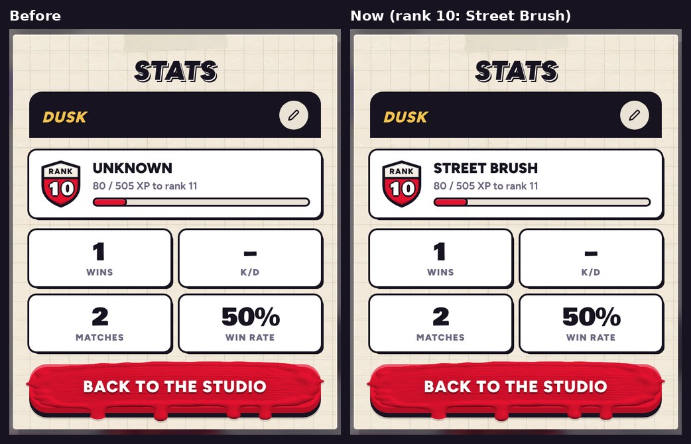

# v343: the Stats card's rank title shows again

- **The title by your rank badge on the Stats card said "Unknown".** Now it's your rank's title: Fresh Paint at ranks 1 to 3, then Drip Rookie, Splat Kid and on (a new one every three ranks).
- **Why:** the card's title and a hidden heading on the Strokes page had the same name in the page. The Strokes page's came first, so your rank's title went there instead, and the card kept its placeholder.
- The card's title has its own name now, and the Strokes page's heading (for screen readers) says Strokes again.

## Tested
In the preview build, on a 390px-wide phone and sideways. 5 checks, all pass:
- **Rank 10:** the card says Street Brush, the title the rank should have.
- **Only one element has the Strokes page heading's name,** and that heading still says Strokes after Stats opens.
- **Rank 13** says Color Bandit and **rank 1** says Fresh Paint.
- **Rank 19, sideways:** Canvas Crusher.

The same checks on v342 show the bug: the card said Unknown at every rank, and the rank's title was written into the Strokes page's heading instead.
