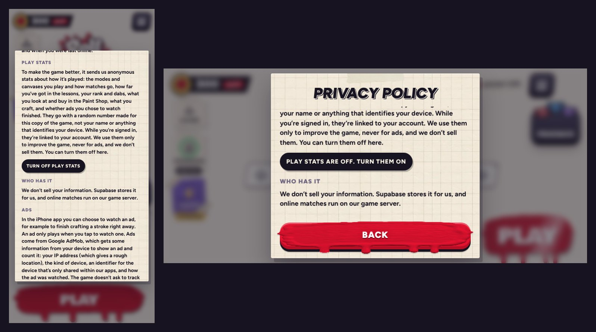

# v354: play stats for the dashboard, and live prices

- **The game sends anonymous play stats** for the admin dashboard (`admin/`). They go to the game's own Supabase project, through `rm_track` (`supabase/migrations/20261018000000_liveops.sql`).
  - **What goes with them:** a random id made for this copy of the game, never a name or anything that identifies the device; the platform and versions; the rank, xp, dabs and tutorial step now.
  - **The events:** sessions; matches (mode, online or not, result, coverage, knock-outs, length, canvas, difficulty); the tutorial steps reached; Paint Shop looks and buys; dabs earned and where from; Strokes crafts and ad skips; rewarded ads (asked, shown, rewarded, failed); ranks reached.
  - **When:** batched, about once a minute while playing and when the app is put away. Kept on the phone while it's offline.
  - **Signed in:** the batch carries the player's token, so their install is linked to them. The server only ever takes that from the token.
  - **Only from the iPhone app.** The web page is the claude.ai preview, so it never sends any, and tests never reach the real project.
- **The Privacy Policy explains them** in a new Play stats section, and its button turns them off (and back on). The choice stays with the phone. The Delete account paragraph now says the stats stay, unlinked.
- **Live prices.** An item's price set in the dashboard reaches the game:
  - at launch, on coming back to the game (at most every 10 minutes), and within about a minute while playing (each batch says when prices have changed);
  - kept with the phone, so prices hold offline;
  - the lesson's own prices and the free gifts stay as they are;
  - the Paint Shop redraws if it's open.
- **The install id, the opt-out and the live prices belong to the phone.** They're never sent up with the account's progress or replaced by it, and they stay through Restart Game and Log out.
- **The iPhone app tells the game its version** (`DeviceBridge.swift`), so the stats can say which app version each install runs.
- **A look at an item that still has to be found on its canvas never counts as one the player could have bought.** The dashboard's suggestions rely on that.

## Before it does anything
Run `supabase/migrations/20261018000000_liveops.sql` in the Supabase SQL editor (see `supabase/README.md`). Until then, the game plays as before with its own prices: it notices the functions aren't there and stops asking.

## Tested
- **Against the real database code** (the migration on a local Postgres behind `supabase/tests/standin.mjs`, a stand-in for Supabase): 24 of 24 checks pass.
  - The web page alone sends nothing.
  - The live price is applied at launch and paid at the Paint Shop. A gift stays free, and the lesson keeps its prices.
  - Every kind of event is queued and lands in the database with the right counts: the session, the looks, the buy, the craft, the ad (asked, shown, rewarded, failed), the skip, the match and its dabs.
  - The install's state is recorded, and it's linked to the player once they're signed in.
  - A price changed later reaches the game with the next batch.
  - The Privacy Policy button turns the stats off and back on, and nothing is sent while they're off.
  - No page errors.
- **The database tests:** 41 of 41 (`cd supabase/tests && npm test`).
- **Earlier checks still pass:** v352's 25 of 25, and v351's 26 of 26 and 7 of 7.
- **The boot check** passes. It now also blocks the real project.
