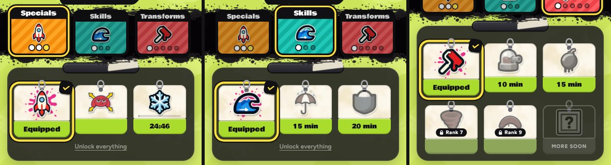

# v323: the stroke cards' strip says what matters

On the Strokes page, the two small icons on each card's lime strip are gone. The strip now shows one of these:
- **Equipped** on the stroke you have on. The check badge in the corner stays.
- **The craft time**, for example "10 min", on a stroke you can craft. This used to be a pill over the picture.
- **The countdown**, for example "24:46", on the stroke being crafted. It ticks every second, and the thin progress bar stays along the bottom of the picture.
- **Nothing** on a stroke you own but don't have on. A locked stroke's strip is also blank, and its lock and rank ("Rank 7") stay on the picture.

The strip keeps its height, so the cards still line up. Sideways, the "More soon" card's strip is now the same height as the others (it was 3px taller).

## Tested
In the preview build, upright and sideways, all three tabs:
- Equipped, crafted, crafting, can-craft and locked cards, plus "More soon", each show the right text.
- No icons are left in any strip.
- The countdown ticks in the strip.
- No page errors.
