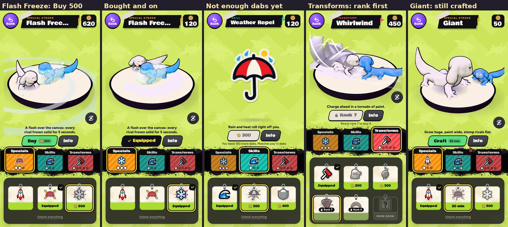

# v370: Strokes bought with dabs (all but the Giant)

## What changed

Every stroke that was crafted on a timer (with Skip as a rewarded ad) is now bought outright with dabs, like the Paint Shop's pieces.
The transforms still open at their ranks first.

| Stroke | Kind | Opens at | Price (dabs) | Was |
| --- | --- | --- | --- | --- |
| Turret | Transform | rank 3 | 200 | a 10 minute craft |
| Weather Repel | Skill | rank 2 | 300 | 15 minutes |
| Paint Trap | Transform | rank 5 | 300 | 15 minutes |
| Deep Pockets | Skill | rank 2 | 400 | 20 minutes |
| Whirlwind | Transform | rank 7 | 400 | 20 minutes |
| Flash Freeze | Special stroke | rank 2 | 500 | 25 minutes |
| Boomerang | Transform | rank 9 | 500 | 25 minutes |

- **Prices:** 20 dabs for each minute the craft took. A win pays about 45 dabs and a loss about 15, so the Turret is four or five
  wins and Flash Freeze or the Boomerang about eleven. They can be changed from the dashboard (Economy, Edit) without a new build, as
  the Paint Shop's are.
- **The Giant** is still crafted (20 minutes) and free: it's Ol' Bloop's lesson (Craft, Skip with a quick ad, Equip).
- **The starters** (Rocket, Swim faster, Roller) are yours from the start, as before.

## On the Strokes page

- **The button:** Buy and the price when you have the dabs; the price alone, greyed, with "You need N more dabs. Matches pay in dabs"
  under it when you don't; a lock and the rank while a transform is still locked.
- **The tags** show each stroke's price where they showed its craft time.
- **Buying puts it on** straight away ("Bought! Flash Freeze is your special stroke").
- **Your dabs** show at the top right, where your rank was, as on the Locker; tap them for your balance. While the Giant is on the
  bench it shows the countdown there, as before.
- **The info card** says how you get it: "Buy it for 400 dabs, from rank 2", or "Opens at rank 7, then buy it for 400 dabs".
- One craft at a time no longer holds anything up: you can buy while the Giant is on the bench.

## Saves

- Strokes crafted before stay yours.
- A stroke on the bench when this update arrives (anything but the Giant) is finished there and then, as if its time had run out.

## Rewarded ads

With only the Giant crafted, Skip (and its rewarded ad) now comes up in the Strokes lesson, or when a player who skipped it crafts the
Giant later. The other strokes no longer show the ad.

## Dashboard

- `admin/catalog.json` gives each stroke's price (and `craft_min` only for the Giant).
- Economy lists the priced strokes with the Paint Shop items: views (once a session, on the Strokes page), buys, dabs, and Edit for a
  live price, which the game applies to a stroke as it does to an item. The audit log names them.
- `admin/API.md`: `view` and `buy` events carry a stroke's id as well as an item's.

## Tested

- **The Strokes page** (18 checks, all pass, upright at 393 x 852 and sideways at 844 x 390), with a rank 5 player holding 620 dabs:
  the badge shows 620; Flash Freeze shows Buy 500 and buying it leaves 120, puts it on and says so; Weather Repel then shows 300 greyed
  with "You need 180 more dabs" and a buy can't go through; the tags show 300 and 400, the Turret 200 and the Paint Trap 300, the
  Whirlwind and Boomerang locked at ranks 7 and 9 ("Reach rank 7 to buy it"); the Paint Trap bought for 300 goes on as the starting
  transform; the info card says "Buy it for 400 dabs, from rank 2". An old save with Deep Pockets on the bench gets it finished and
  owned. The Giant still shows Craft 20 min and its craft starts (the countdown on the badge); Flash Freeze can be bought while it's
  on the bench. No page errors.
- **The earlier tests** pass on this build: the v352 checks (25 of 25), v351's two (26 of 26, 7 of 7), v355's (27 of 27) and v354's
  (25 of 25), and the dashboard's end-to-end (38 steps) and live tests (13 steps). Three checks that crafted Flash Freeze, Weather
  Repel or the Turret now craft the Giant, and v354's gained one: a stroke bought with dabs sends its buy, counted with the price paid.
