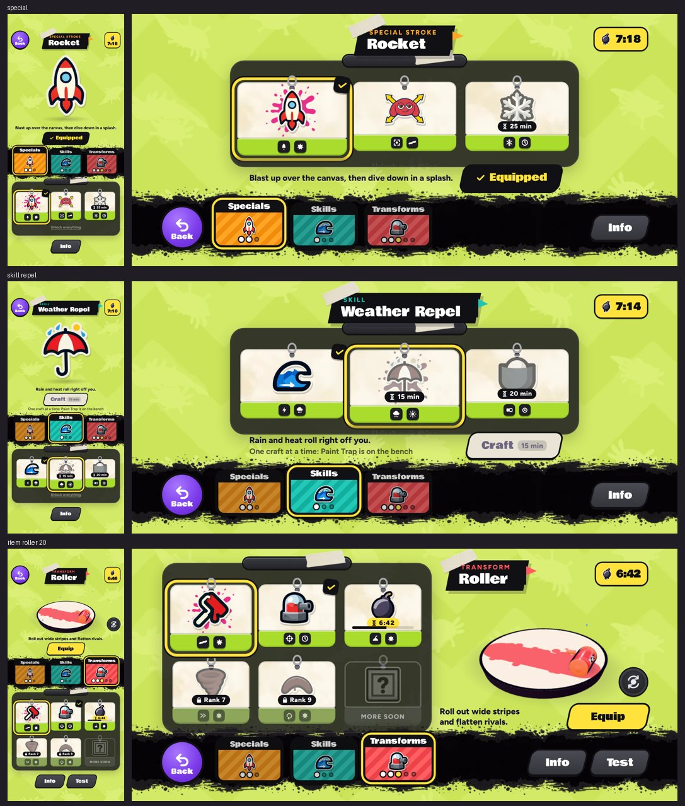

# v313: the Strokes page as a gear screen

The Strokes page now looks and works like a gear screen from Splatoon 2, in Roll Model's paper, tape and paint.

## The layout

- **Background:** a pale lime wall with a black ink band across it.
- **Categories:** Specials, Skills and Transforms sit on the ink band as tab cards. Each card shows the stroke you have on, with a dot for each stroke in that category.
- **Strokes:** they hang in a dark panel as tags. Each tag says one of these:
  - the rank it opens at,
  - how long it takes to craft,
  - the countdown on the bench,
  - a check mark for the one you have on.
- **The stroke you're looking at:** it's named on a black banner, with a line on what it does and one button: Equip, Craft, or Skip.
- **Info** opens a sheet with what the stroke does, its numbers, and how you get it.

## Transforms show what they do

On the right (at the top when upright), your own axolotl uses the transform on a small pad against a rival:

| Transform | What the demo shows |
|---|---|
| Roller | Rolls out a stripe and flattens the rival |
| Turret | Plants and fires until the rival is out |
| Paint Trap | Gets set, then goes off under the rival |
| Whirlwind | Winds up and charges through the rival |
| Boomerang | Loops out through the rival and comes back |

- Drag the demo, or use the round button, to turn the view.
- **Test** plays the demo bigger, with a caption for each step.
- Specials and skills have no demo, so their page is centred.

## Also

- Ol' Bloop's Strokes lesson walks you through the new page.
- "Unlock everything" (code 1234) is at the foot of the panel.
- The demo only runs while the Transforms tab is open.
- The art (the wall, the ink band and the cards) is made with Ludo.
