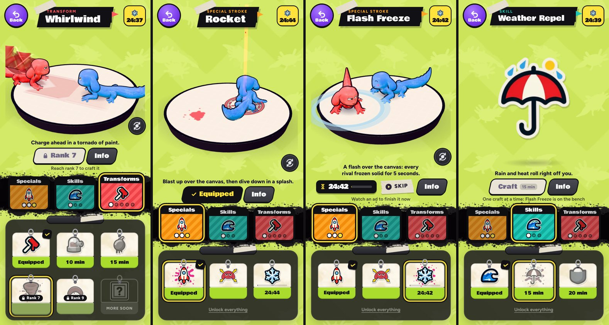

# v325: Info beside the main button, no Test

On the Strokes page:
- **Test is gone.** That was the button that replayed the demo with captions. The demo still plays on its own as before. With reduced motion on, it stays still, as it did before unless you pressed Test.
- **Info sits beside the main button.** It is the same height and slant, in the dark of the old button, next to Equip, Craft or the lock that names the rank (for example "Rank 7"). While a stroke is being crafted, it sits next to Skip. It opens the same Info sheet, and closing the sheet puts focus back on it.
- **Upright,** the row of buttons under the panel is gone, so the stroke's window above gets that room.
- **Sideways,** the band along the bottom keeps just Back and the tabs.
- **On phones under 380px wide,** the crafting timer drops its small progress bar so the timer, Skip and Info fit in one row. The card in the panel still shows the progress bar.
- **The turn-the-view button** now sits just above the text and buttons under the demo, however tall they are. Sideways, it used to cover the end of "Watch an ad to finish it now".

## Tested
In the preview build, on 390px and 320px-wide phones and sideways, 26 checks, all passing:
- In each state (equipped, can craft, locked, crafting), Info sits level with the main button and just to its right, and everything stays on screen.
- No Test button or bottom button row is left.
- Info opens the sheet for the selected stroke, and focus comes back to it.
- The page closes and reopens cleanly.
- The turn-the-view button stays clear of the text below it.
- No page errors.

Separately, the Strokes lesson still runs on the page.
