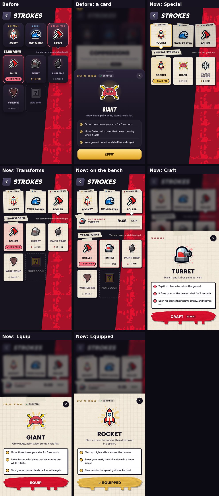

# Strokes page in the studio look (v287)

Built in `tools/v287_strokes_paper.py`. The Strokes page had its own dark glossy panels; now it's made of the same pieces as the lobby,
Commissions and the rest of the studio.

- **Loadout slots:** cards of the studio's graph paper, a touch crooked, each held down by a strip of masking tape that names it
  (Special, Skill, Transform). The one you're looking at sits straight and lifted, ringed in its colour; the others sit back a little.
- **Heading:** a tape label.
- **Tiles:** paper outlined in ink with a hard shadow, like the Commissions rows. The picture sits on a dab of its slot's colour (gold
  specials, blue skills, red transforms). The equipped one is taped down and washed in its colour; ones still to craft or locked are
  greyed paper; More soon is a dashed outline.
- **Bench:** a paper strip taped at its corner, its bar filling in the slot's colour. Skip is a tape button.
- **Card:** a sheet of the graph paper with tape across its top edge, ink type, what it does in an outlined white box, and the stroke
  button (your paint, with its drip) for Craft and Equip. Equipped, the stroke is the slot's colour.
- Landscape keeps its layout (slots down the left, grid on the right) in the same look.
