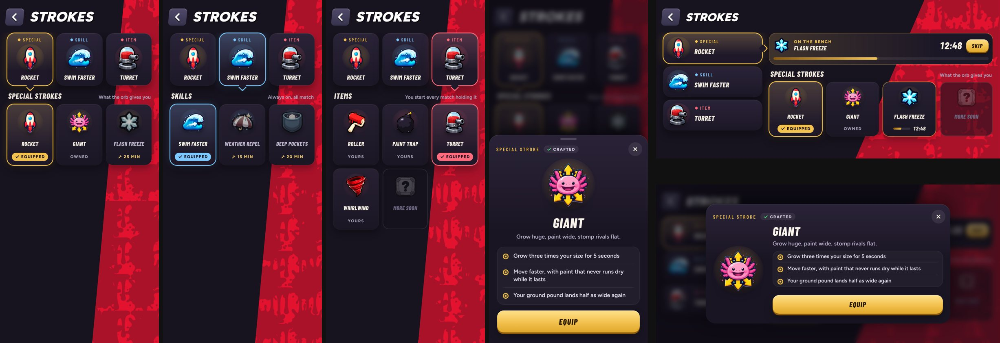

# Strokes page as a loadout (v275)

The Strokes page had grown long: three tall paper sections (Special stroke, Skill, Item), each repeating the equipped stroke in a big
row above its own sideways rail of thick-outlined tiles, so a phone had to scroll past all of it. Built in `tools/v275_strokes.py`.

## Layout

- **Loadout up top**: three slots side by side (Special, Skill, Item), each showing the stroke you have on, its picture on a glow of the
  slot's color (gold specials, blue skills, red items). They are the page's tabs: the one you're on has a ring of its color and a notch
  pointing down into the grid. Arrow keys move along them. A slot with something newly crafted carries a red dot.
- **One collection at a time**, in a grid under the slots (three across in portrait): the tab's name and a line on what it's for
  ("What the orb gives you", "Always on, all match", "You start every match holding it").
- **Tiles**: dark cards, the picture on a glow, the name in condensed italic caps, and a status line along the foot: Equipped (a pill
  in the slot's color), Owned or Yours, the craft time (hourglass) on one still to craft, a bar and the time left while it's on the bench,
  the rank it opens at, or New. "More soon" shows only where it doesn't start a row of its own.
- **The bench**: a craft in progress is one bar under the loadout: the stroke's picture, its name, the time left, Skip, and a bar in its
  slot's color.
- **The card** a tile opens is a sheet risen from the foot of the screen in portrait (centred in landscape): the slot's label and an
  Owned/Equipped chip, the picture big on a glow, the name, what it does in hairline rows, and one button at a time: Craft (with its
  time), the bench's countdown and Skip, or Equip.
- **Landscape**: the three slots stacked down the left, the bench and the grid on the right; the card puts the picture on the left and
  everything else in a column beside it so it fits a short screen.
- Small phones (320 wide) get slightly smaller pictures and type.

## Ol' Bloop's lesson

The lesson keeps the Special tab up while it walks you through the Giant (tap it, Craft, Skip, Equip). Its last line now says skills
and items have their own tabs. On a wide screen his plate is a little narrower on this page so it can sit to the left of the grid
without covering the Giant.

## Notes

- No `color-mix()` (older iOS web views lack it): the slot colors are carried as `--sk` and `--skrgb` for the glows.
- The page keeps its ids (`stSpecialRail`, `stSkillRail`, `stItemRail`, `stCraft`, `stSkip`, `stPop*`), so the lesson and the
  rest of the game find what they did.
