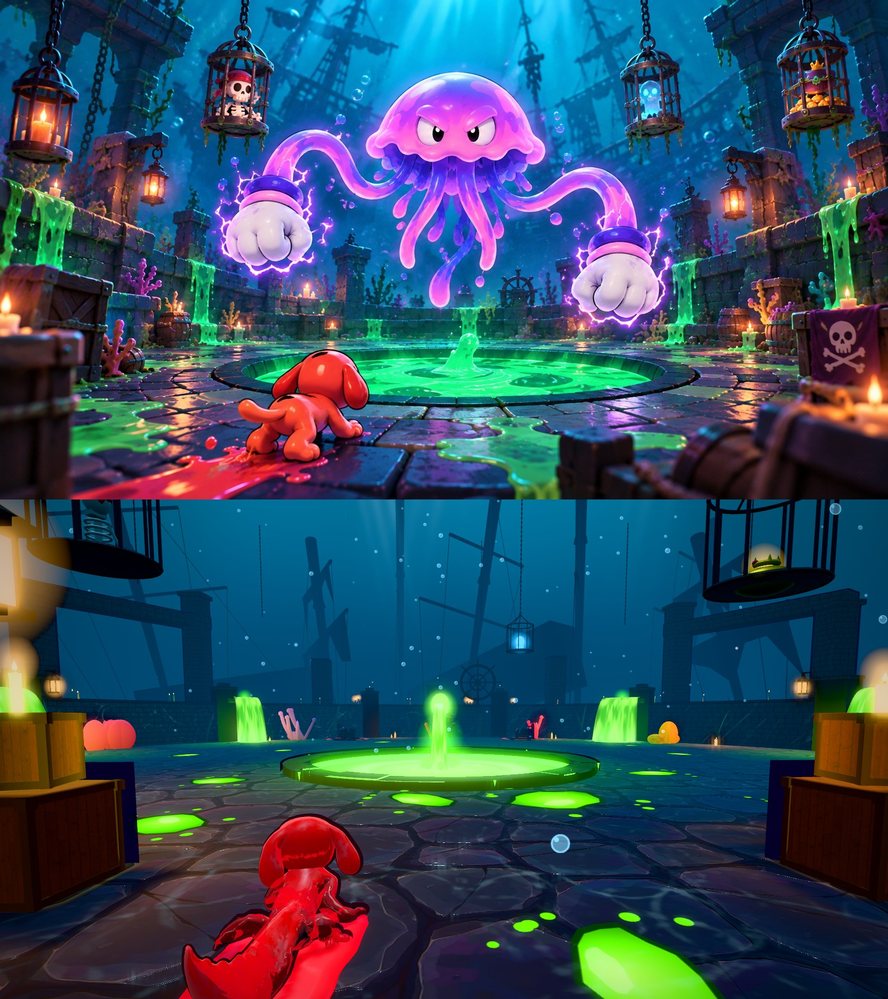

# The Sunken Keep (v309): the Season Conquest stage

The Season Conquest boss arena, built by hand to the concept picture: a round floor of wet flagstones at the bottom of the sea, a
low stone parapet with square posts all round (the wall stands at r = 17.5), the glowing slime pool in the middle (r = 4, its curb to
r = 4.7) with the spout rising from its centre, slime pouring over the wall in four places, ruined pillars and arches behind the
wall, chains from above holding the three cages (the pirate skeleton, the little ghost, the gold and the crown), lanterns and
candles, the ship's wheel on the far wall, coral and kelp, crates and barrels in the front corners with the skull flag draped over
the right-hand crate, and the wrecks' masts and sails beyond, in the haze.

- Textures: the floor slabs, the wall blocks, the planks and the sea bed are colour maps made with Ludo.ai (tools/v309_conquest_tex.py,
  about 120 KB of webp); their relief and gloss (normal and roughness maps) are worked out from the colour map when it loads.
- Underwater: a dome of water above (deep blue-teal, brighter toward the surface, a slow shimmer), light shafts, caustic ripples,
  bubbles rising, kelp swaying in the current, the haze deepening with distance.
- Play: the floor paints like every stage. The wall holds you in; the pool is a hole (fall in and you are out for a moment, as in any
  pit) and its curb holds you off unless you hop it. The space above the pool is left empty for the boss.
- How to see it: Choose Event, the Season Conquest card ("Stage preview"): just you on the stage, no clock, no rival; Pause, Menu
  comes back.
- Cost: about 50 draw calls and 160k triangles a frame (a crypt versus match: about 135 calls and 200k).
