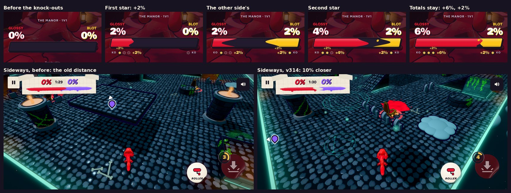

# v314: a smaller knock-out bonus, a closer sideways view, a calmer giant

## 1. The knock-out bonus in the tally

The big "Knock-out bonus" headline is gone. It was as big as the result itself, and the paint result is the story.

- Under the bar, each side gets one small row: "KO" and a star for each of its knock-outs, dim at first.
- In turn, each star fills gold. A little "+2%" rises off it, and that side's paint on the bar and its number go up by 2 at the same moment, with a small splat where it lands.
- The row ends on the side's total (for example "+6%") and stays there, small, under the bar until the winner shows.
- It's quicker: about a third of a second per knock-out (it was 0.62 s), the two sides taking turns.
- Nothing flies across the screen any more, and the number gets no badge.
- A side with no knock-outs shows nothing.

## 2. Sideways, the play view is 10% closer

Playing sideways (landscape), the camera sits 10% closer: its height and its distance behind you are both scaled by 0.9. You see less of the stage, and your character is a little bigger. Upright play is unchanged.

## 3. Turning as a giant is 30% gentler

A giant rolls 1.75 times as fast. The faster roll also let it turn about 30% quicker than a normal roll, which made it twitchy. Your turning is now 30% gentler while you're a giant, so it turns about like a normal roll does. When the giant wears off, turning is back to normal. The CPUs are unchanged.

## Tested

- **The tally:** checked with 3 knock-outs against 1, upright and sideways, at each step. The rows appear under the bar, the stars fill one by one, the numbers and the bar go up by 2 each time, and the totals stay to the end.
- **The camera:** sideways shots before and after from the same moment of a match.
- **Turning:** the turn rate at full steer, worked out exactly from the game's own steering. As a giant it's 0.7 of what it was. A normal roll is the same as before.
