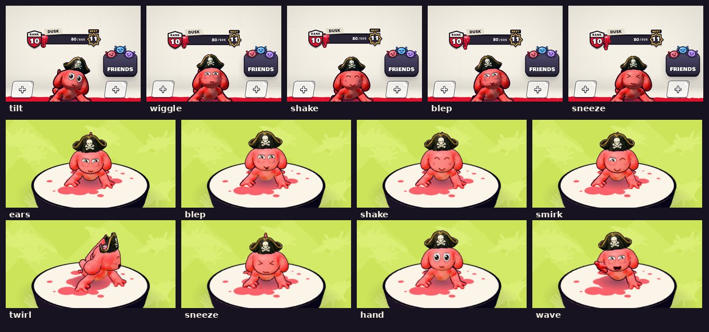

# v328: tapping your character

Tapping your character in the lobby used to start the hop again on every touch, so a quick run of taps kept it bouncing in mid-air. Now:

- **One reaction at a time.** A tap plays one reaction, and taps do nothing until it's finished. That's between about one and two seconds, depending on the reaction.
- **Not the same thing each time.**
  - The first tap is a hop.
  - After that, each tap plays one of the moods your character already does on its own: a wave, a blep, chin up with a smirk, a wet-dog shake, peekaboo behind its ears, a sneeze, a wag, a tilt of the head, a look round, or a wiggle.
  - They come in a shuffled order, never the same one twice in a row. The hop comes round again once in each round.
- **In the locker page's window,** your character works the same way, with what it can do there:
  - a hop, a wave, a hand up, or its ears up in surprise;
  - a blep, a smirk, a sneeze with a puff of paint, a wet-dog shake, or a twirl.
- **Other actions still work as before:**
  - Dragging still spins you, and it stops a reaction that's under way.
  - Trying something on, or changing your paint or eyes, takes over from a reaction.
  - With reduced motion on, the twirl is left out.

## Tested
In the preview build, on a 390px-wide phone and sideways, both in the lobby and in the locker's window:
- the first tap hops;
- a run of fast taps during a reaction does nothing;
- the next tap after a reaction finishes plays a different one, and every reaction in a round plays once before any repeats;
- nothing plays twice in a row;
- each reaction tidies up after itself;
- a drag stops a reaction, and a try-on takes over;
- no page errors.
