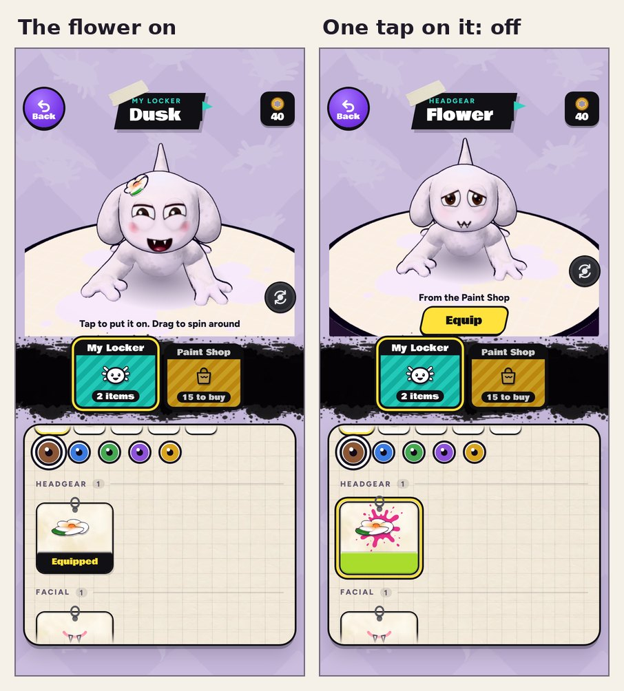

# v363: tapping something you have on takes it off

- **My Locker:** tap a thing you're wearing (the flower, the fangs, a hat) and it comes off; tap it again and it goes back
  on. Before, a tap on a thing you had on only picked it, and the Take off button under the banner was the only way to take
  it off. Take off still works.
- **The Paint Shop:** what you buy stays listed there until you leave. Once you've picked a thing you bought, tapping it
  again takes it off, and again puts it back on. The first tap still just picks it.
- **Eyes** are swapped, not taken off (there's always a pair), so they work as before.

Your character pouts when something comes off, as with Take off.

## Tested

Real taps at each card's place on the screen, on the build before and this one:

- Before: tapping the flower you have on did nothing (three taps, still on). Take off worked.
- v363 (all as described): the flower off with one tap, back on with the next, off with Take off, on again with a tap;
  in the Paint Shop, the fangs bought, then off with a tap and back on with the next; in My Locker the fangs off and on
  again; the Round eyes stay on. What you wear is saved each time, and there were no page errors.
- The lesson's shop step (buy the flower, then the fangs, then open your locker) goes through as before.
- The earlier tests (the v352, v351, v355 and v354 checks, and the dashboard's end-to-end and live tests) pass on this
  build.
