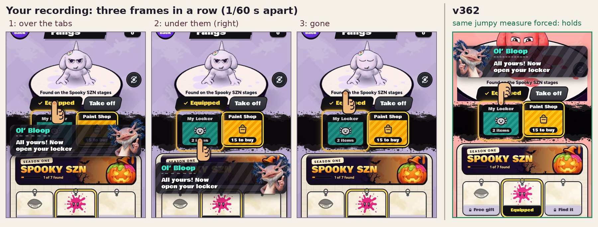

# v362: Ol' Bloop's plate holds still on the locker page, and any way out of the rival's pound passes the dodge

## The flickering plate on the locker page

After buying the fangs, the Paint Shop tab says "All yours! Now open your locker". In your recording the plate moved every
frame, round three places: over the tabs (the hand on Equipped), under the tabs (the hand on My Locker, where it should
be), and gone, for as long as the page was up.

The plate's place is measured every frame, from its own height and the tab's. Working back from where it landed in each
frame, on your phone that measure came out different from one frame to the next (as if the plate were about three times
its real height, by a different amount each frame), and the plate went wherever each frame's measure put it. The test
browser always measures it right, so I couldn't find what makes the phone do that. What changed instead is how the
plate moves:

- It goes where it's measured to go the moment the tip comes up, and when the screen changes size.
- After that it only moves to a new place once that place has held for three frames in a row, or as it slides (a scroll,
  the page coming in), or when the new place is the natural one and the place it's in had been squeezed against an edge.
- A place that one frame's measure gives and the next frame takes back never moves it.

With the same jumpy measure forced in the test browser, the build before jumps between three places every frame, like
your recording, and v362 holds the natural place. I couldn't check it on an iPhone, so that step is worth a look on yours. This covers every tip
that points at a control, not just this one.

## The dodge

The lesson's dodge step still says "Swipe up just before it lands to dodge" (and "NOW! Swipe up!" in the slow motion), but
any way out of the rival's pound now passes it:

- a swipe (the dodge roll), as before,
- a jump that has you in the air when it lands,
- a fling with the slingshot,
- or just getting out of its way.

His pound has to come down near you and miss you. Getting caught twice still passes the step, as before.

## Tested

- **The plate, as it is** (the lesson's shop step played through: buy the flower, buy the fangs): one place over 120
  frames, the same as before.
- **The phone's jumping measure, forced** (the plate's height read as 315, 439 and 464 px in turn, every frame, which is
  what the recording works out to): the build before moved the plate between three places every frame (119 changes in
  120 frames, the flicker in your recording); v362 holds one place, the natural one (0 changes).
- **The tab's place jumping instead** (up 113 and 138 px in turn): before, three places every frame; v362, one place
  (the first one measured).
- **Scrolling**: the flower's tip follows its card while the shop scrolls, the same as before (at most two frames behind
  when it swaps from over the card to under it).
- **Tapping My Locker** still goes on to the next step.
- **The dodge, played five ways** (the first lesson played with touches up to the dodge step, then):
  - swipe up on "NOW!": passed on the first pound, as before;
  - fling with the slingshot on "NOW!": passed on the first pound;
  - jump on "NOW!": the first jump was too late and got caught ("Too late!"), the second cleared it and passed;
  - run away from the pound: caught once, then clear of the second, passed;
  - do nothing: caught once, then the second pound missed (it had crawled out of reach), passed.
- No page errors in any of it.

The earlier tests (the v352, v351, v355 and v354 checks, and the dashboard's end-to-end and live tests) pass on this
build.
