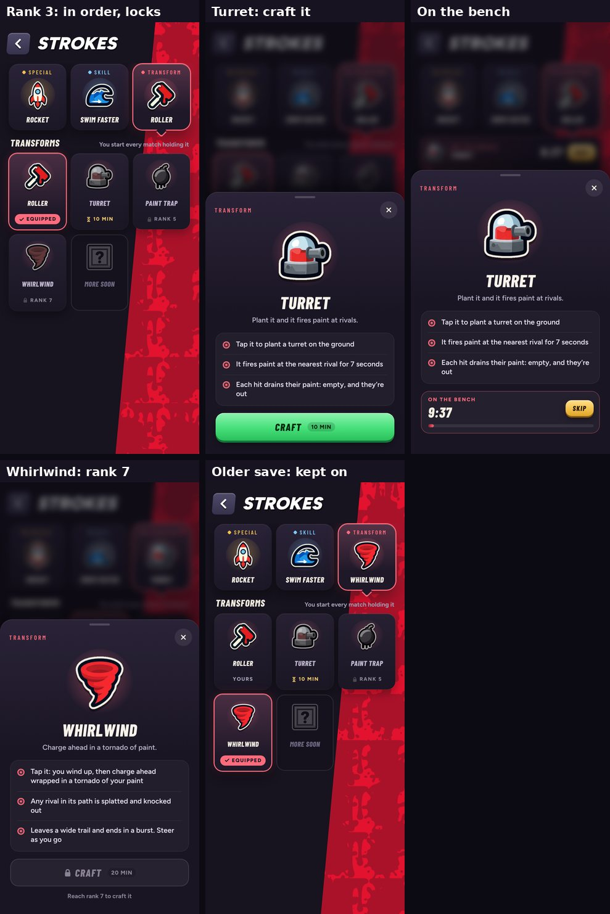

# Transforms are earned: rank, then craft (v286)

Built in `tools/v286_items_craft.py`.

The transform is the item you hold as every match begins (Strokes page, third slot).

- New order: Roller, Turret, Paint Trap, Whirlwind (the Turret and the Paint Trap swapped places).
- The Roller is yours from the start.
- Each of the others opens at a rank and is then crafted on the bench, like the strokes:

| Transform | Opens at | Craft |
| --- | --- | --- |
| Roller | yours from the start | none |
| Turret | rank 3 | 10 min |
| Paint Trap | rank 5 | 15 min |
| Whirlwind | rank 7 | 20 min |

- Before its rank, its tile shows the rank with a lock, and its card's Craft is greyed with "Reach rank N to craft it".
- From its rank, its tile shows the craft time. Craft puts it on the bench (one craft at a time, shared with the strokes), with Skip as
  before. Once crafted it's yours: Equip, and you start every match holding it. A newly crafted one puts a dot on the Transform slot.
- Only one you own can be on; anything else falls back to the Roller.
- A save from before keeps the transform it had on (as when skills became crafted); the rest go to the bench.
- The CPUs still start with any of the four at random, and items on the canvas are unchanged.
