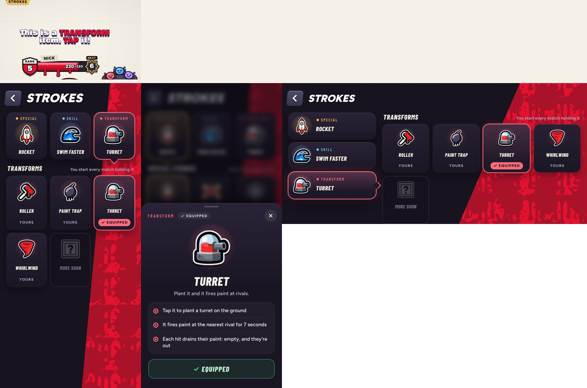

# Transforms (v281)

The pick-ups (the Roller, the Turret, the Paint Trap, the Whirlwind) are now called **Transforms**: grab one and you change into it.
Built in `tools/v281_transforms.py`. Only the words change; the code still calls them items.

- **The lesson:** when the roller turns up, the callout says "This is a TRANSFORM item. TAP it!" (or "Press F!" on a keyboard).
  On a phone it wraps into two even lines. The lesson's closing checklist says "Transforms" where it said "The roller".
- **Strokes page:** the third tab reads Transform, its heading Transforms, a card's label Transform, and equipping one says
  "Turret is your starting transform".
- **How to play:** the card is headed Transforms, and its text names all four and says you start every match holding the one you
  picked under Strokes.
- **Ol' Bloop:** "Skills and transforms have their own tabs" and "the transform you start with".
- **Unchanged:** the locker's wearables (hats, masks, eyes) are still "items", because they're a different thing.
