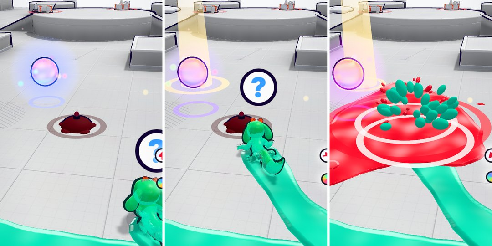

# v365: CPUs run over your paint traps

How often a CPU that comes to one of your traps gets caught by it:

| CPU level | Before | Now | You asked for |
| --- | --- | --- | --- |
| Easy | 40% | 65% | 65% |
| Medium | 28% | 41% | 40% |
| Hard | 19% | 23% | under 30% |

## What was going on

- A CPU's steering never took traps into account at all. It only got caught when its way happened to cross a trap's
  middle, which wasn't often: passing one unit to the side of it missed (a unit is about a trap's radius).
- When one was heading straight at a trap, it rolled through it harmlessly 30% of the time on easy, 55% on medium and
  80% on hard. That roll is the "too smart" part you saw.

## What it does now

- The first time one of your traps lies ahead of a CPU, within about 4 units and less than 2 to the side of the line it's
  on, the CPU either hasn't seen it or has. Easy hasn't seen it 65% of the time, medium 40%, hard 25%.
- **Hasn't seen it:** it rolls straight on over it, bending its line a little if the trap is off to one side. No hop,
  roll, slingshot or pound on the way.
- **Has seen it:** it steers round it. If it's still dead ahead at the last moment it rolls through it, or hops it if its
  roll isn't ready yet.
- Once it's well past the trap it forgets, so the next time it comes that way is a new roll of the dice.
- Its slingshot follows the same odds: it won't fling itself onto a trap it has seen (or not come to yet). Before, its
  flings didn't look out for traps at all, so a CPU flinging itself at you could land on the trap you'd just dropped.
- The same goes for traps one CPU drops in another's way in a 3-way. Nothing changed for you: your own traps still can't
  catch you, and a CPU's trap catches you as before. A giant still sets a trap off harmlessly, and a CPU already in the
  air still clears one.

## Tested

The table above is from CPU matches played faster than real time, with you played by the game's AI too. A trap of yours
goes down 3.4 to 5 units ahead of a CPU that's rolling along: straight ahead, or up to 1.3 units to one side. Every time
a CPU came within 2 units of a trap's middle on the ground counts once. Each level had 15 minutes of 1v1 and 15 of
3-way, on the build before and this one (about 270 to 390 times per level):

| CPU level | 1v1 before | 1v1 now | 3-way before | 3-way now |
| --- | --- | --- | --- | --- |
| Easy | 45 of 112 (40%) | 84 of 130 (65%) | 90 of 226 (40%) | 171 of 263 (65%) |
| Medium | 30 of 116 (26%) | 40 of 104 (38%) | 73 of 250 (29%) | 111 of 267 (42%) |
| Hard | 11 of 95 (12%) | 17 of 86 (20%) | 49 of 227 (22%) | 46 of 186 (25%) |

- It's a roll of the dice each time, so one run differs a little from the next. Over all my runs while building this
  (the in-between versions too), hard came out between 20% and 29%.
- When a CPU had decided it hadn't seen the trap, it got caught 96% of the time (426 of 442). When it had seen it, 6%
  (26 of 454).
- A longer test with you dropping a trap whenever a CPU was near, each trap staying down its full 45 seconds: CPUs pass
  the same trap more than once, and each pass is a new roll, so a trap down a while catches someone more often than
  the numbers above.
- No page errors in any of it.
- The earlier tests (the v352, v351, v355 and v354 checks, and the dashboard's end-to-end and live tests) pass on this
  build.
