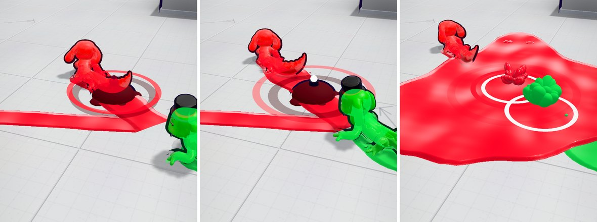

# v366: a CPU right on your tail gets caught by the trap you just dropped

## What was still wrong after v365

v365 made CPUs run over your traps at the odds you asked for, but only once a trap had armed, and a trap takes 0.6
seconds to arm after you drop it. The most common time to drop one is with a CPU chasing you, and a CPU 2 or 3 units
behind you reaches that spot in under half a second. It rolled over a trap that wasn't armed yet, and nothing happened.

## What it does now

- A CPU makes up its mind about your trap the moment you drop it, while it's still arming, with the same odds: easy
  65%, medium 40%, hard 25%.
- **It hasn't seen it:** the trap catches it as soon as it has been down a beat (0.15 seconds), armed or not.
- **It has seen it:** it steers round it, or rolls or hops over it. Rolling over a trap that's still arming leaves the
  trap where it is.
- Nothing changes for you: a CPU's trap still has to arm before it can catch you.
- A CPU only bends its line toward a trap it hasn't seen when the trap is fairly straight ahead (within about 35
  degrees, when it's close), so a trap dropped right beside it doesn't pull it round in a hard turn.

## Tested

**The chase.** You roll along a clear lane on Blank Canvas with a CPU 1.6 to 3.1 units behind you, hunting you, and you
drop a trap. Counting every time the CPU went over the trap or touched it:

| CPU level | v365 | Now | You asked for |
| --- | --- | --- | --- |
| Easy | 38 of 63 (60%) | 163 of 242 (67%) | 65% |
| Medium | 28 of 79 (35%) | 93 of 230 (40%) | 40% |
| Hard | 11 of 68 (16%) | 39 of 161 (24%) | under 30% |

In v365, 73 of those 210 (35%) were the CPU rolling right over a trap that hadn't armed yet, with nothing happening.

**v365's test** (a trap put down a few units ahead of a CPU rolling along, in 1v1 and 3-way matches) comes out the same
as before: easy 273 of 444 (61%), medium 172 of 434 (40%), hard 266 of 1,070 (25%). Counted the same way, v365 was
64%, 39% and 22%. v365's notes only counted CPUs that came within 2 units of the trap. Now that CPUs make up their
minds sooner, more of the ones that have seen a trap steer more than 2 units wide of it, so these numbers count every
CPU that had the trap in its way.

- The dice themselves, counted inside the game: 24 of 106 hard CPUs (23%) hadn't seen the trap, against 25% set.
- No page errors.
- The earlier tests (the v352, v351, v355 and v354 checks, and the dashboard's end-to-end and live tests) pass on this
  build.
