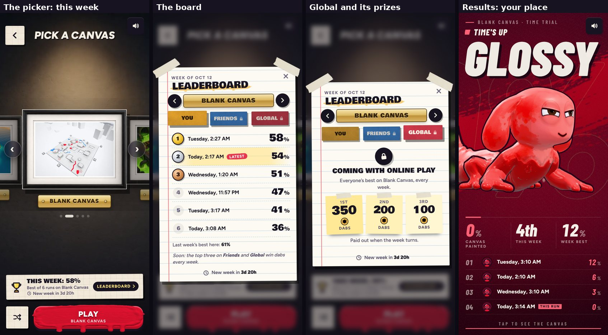

# v293: Time trial weekly leaderboards, and a performance pass for phones

## Time trial: a leaderboard a week, one per canvas

- Every canvas has its own board for the week. The week runs from Monday 00:00 UTC, the same moment for everyone, so the online boards
  can turn together later.
- For now the board is you against yourself: your runs this week on that canvas, best first. First, second and third get gold, silver
  and bronze. Your latest run is marked. When the week turns the boards clear, and last week's best on a canvas stays on show.
- In Time trial the canvas picker has a strip under the pictures: your best this week on the canvas in the middle, how many runs, and
  when the week turns. Tap it to open the board. The board is a taped sheet of lined paper with the canvas on a plaque (the arrows flip
  through every canvas), You, Friends and Global tabs, and a countdown to the new week.
- Friends and Global are there now, locked until online play. Each shows the prizes for the week's top three:
  - Global: 350, 200 and 100 dabs.
  - Friends: 100, 60 and 30 dabs. A friends board needs 3 friends or more on it to pay out.
  - The 350 and 100 for first place are what was asked for. Second and third (200/100 and 60/30) are suggestions, easy to change.
- A run now counts against the week: the HUD bar fills toward this week's best on this canvas. The results show where the run placed
  ("4th this week"), the week's best, and the week's top three under the stats with this run marked (and listed under them if it placed
  lower). "Best this week" replaces "New best".
- The Time trial card on the events page says "Weekly leaderboard". Stats still keeps your all-time best.

## Performance: less heat, same look

Measured on the phone settings in a four-player Showdown in Graphics mode, before the change:

- About 11 ms of script per frame on a fast desktop core (more on a phone): about 5 ms for the renderer, 3 ms for game logic and AI,
  3 ms for animation.
- The main pass drew 74 meshes and about 305k triangles. 57% of the triangles were the four characters (body, ink line and
  see-through silhouette, plus the shadow pass).
- The frame went into a 4x multisampled HDR target. On the newest iPhones that target was 2x the screen's points.
- The quality ladder climbed in the menus, where little is drawn, to its most expensive level: the floor mirror, the depth blur, the
  mid-frame see-through copy and full resolution. Matches started there and only stepped down after frames were already late, so the
  phone ran hot first and then hitched.

What changed:

- **A match budget on phones.** In a match the floor mirror and the mid-frame see-through copy stay off. The resolution is capped at
  1.6x the screen's points, or 1.5x in Showdown with four fighters. The 4x antialiasing, bloom, shadows and materials are unchanged.
  Menus keep everything. On the newest iPhones that's about 36% fewer pixels per frame in a versus match and 44% fewer in Showdown.
  On the iPhone 12 to 14 range, Showdown draws 12% fewer.
- **Easing off before the heat.** When the iOS shell reports the phone as warm ("fair", the step before "serious"), a match drops the
  depth blur and 10% of the resolution so it doesn't reach the point where iOS throttles it. Both come back as the phone cools.
- **Matrices.** three.js recalculated the matrix of every object in the scene every frame: about 2,000 in a match, two thirds of
  them hidden (effect pools, other forms, spare pieces). Now it recalculates only what moved and skips anything under something hidden
  until it shows. Matrix time per frame went from 1.2 ms to 0.45 ms on the desktop profile.
- **Nothing is drawn behind the Strokes page.** It covers the whole screen, as the canvas picker and the events page already do.

Checked: a Showdown at phone settings runs at 1.6x in the menu, 1.5x in the match and 1.6x back in the menu. The match frames look as
before, with the characters animating and wearables in place. A Time trial runs through to the results with the board updated. The
release boots clean.
