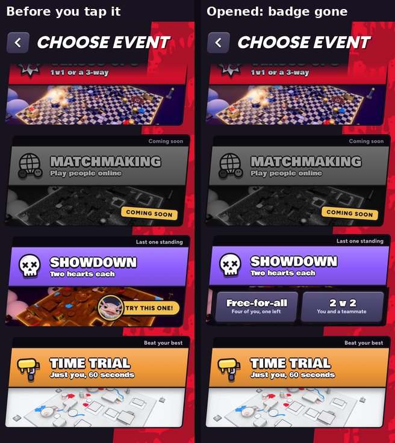

# "Try this one!" goes when the Showdown card opens (v290)

Built in `tools/v290_trysd_open.py`.

- Ol' Bloop's "Try this one!" sat over the 2v2 button once the Showdown card was opened.
- Now it goes for good the moment you open the Showdown card, so both options (Free-for-all and 2v2) are clear. As before, it also
  goes once you leave the page.
