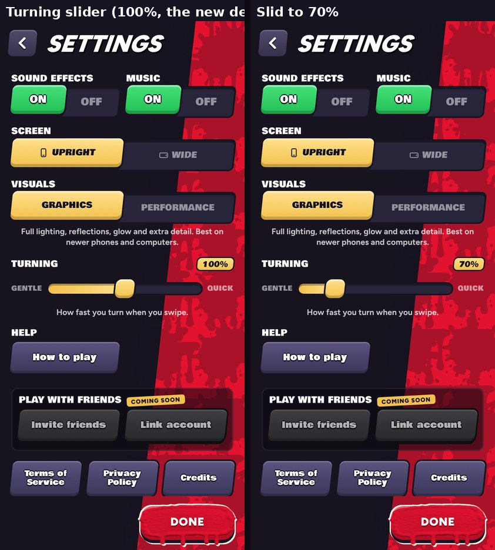

# v295: gentler turning, a calmer camera, and a Turning slider

A player said the view made them dizzy.

- **Turning is about 10% slower by default.** Measured with a full swipe held in an open spot, each case in a fresh match, the
  turn rate went from 4.17 to 3.73 rad/s (10.5% slower). The steering helpers scale with it. The kill cam and the CPUs are unchanged.
- **A Turning slider in Settings**, between Visuals and Help. It runs from Gentle to Quick, 50% to 150% in steps of 5, with 100%
  as the new default. It's saved with the game and applies straight away. At 50% the turn rate measured 2.0 rad/s, at 150% 5.9 rad/s.
- **The camera eases after you.** Its swing round behind you starts and stops more gently (it settles in 0.3 s, was 0.21 s), with a
  little more lead into the turn. In a long full turn it now trails about 35 degrees behind (was about 31) and swings at most
  3.8 rad/s (was 4.3). A spin on the spot can't whip the view faster than 250 degrees a second. Its position and aim follow a touch
  more softly.
- **The view no longer tilts** when you lean into a turn. Rolling the horizon is one of the surest causes of motion sickness.
