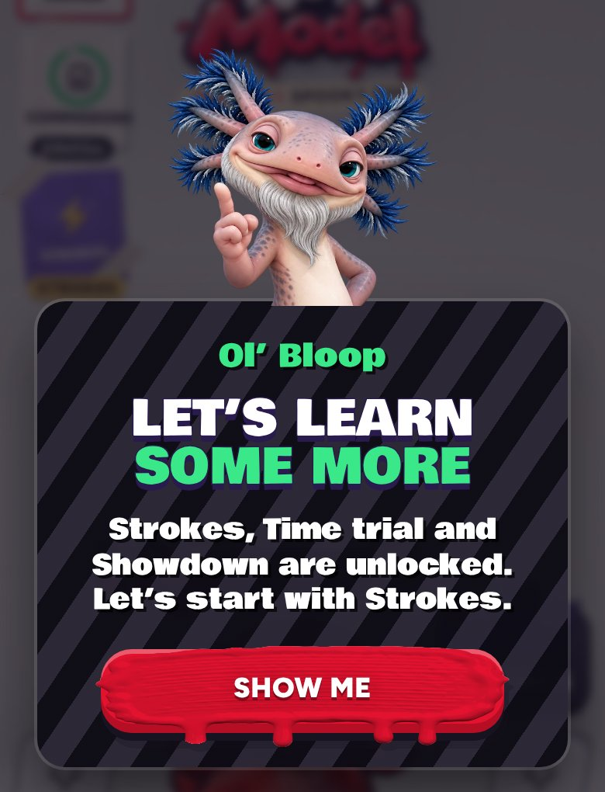

# Ol' Bloop's "Let's learn some more", shorter (v292)

Built in `tools/v292_unlock_line.py`.

- The card that opens Strokes now reads "Strokes, Time trial and Showdown are unlocked. Let's start with Strokes." (was "You've
  unlocked Strokes: your special move, a skill and the transform you start with. Time trial and Showdown are open now too. Strokes
  first: come see.").
- Same heading and Show me button.
