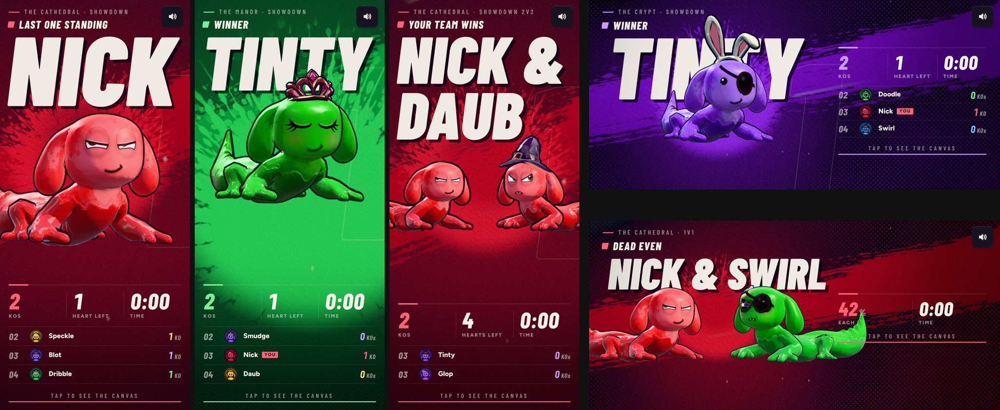

# Victory screen as a fight poster (v274)

The winner screen is rebuilt around one idea: a fight poster, not a party. Built in `tools/v274_victory.py`.

## Look

- **Backdrop** (shader, `VIC_FS`): near-black ink tinted with the winner's color, a low glow behind the winner, slow smoke, halftone dots toward the corners, embers drifting up, film grain and a vignette. The foot of the screen (portrait) or the right side (landscape) is darkened for the words.
- **The slash**: one dry-brush stroke right across the screen behind the winner, in a deep shade of its color, swept in from the left. The stroke is a real ink texture generated with Ludo (`game/art/vic_brush.webp`), tinted in the shader.
- **The name** is drawn into a canvas the size of the screen and sampled by the backdrop, so the winner stands in front of it (its head and hat over the foot of the name). Condensed italic (Barlow Condensed 900), cream with a hard ink shadow, slammed down from 125% size. A huge outline of the place ("1", or the coverage in Time trial) sits faintly behind.
- **The words** over it: the stage and event in small spaced caps, a kicker over the name (Last one standing, Your team wins, Victory, Winner, Dead even, New best, Time's up), a row of stats in big italic numerals over hairlines, the rest of the field in thin rows (place, face, name, a You tag, their KOs or paint), and a "Tap to see the canvas" line with a bar that fills as the screen counts down.
- **Landscape**: the winner and its name on the left (the name on one line), the words in a column on the right.

## The winner

- A new face, `menace`: heavy lids drawn down nearly level across the eyes with a slight scowl, the lower lids pushed up, and a crooked sneer (one corner hitched up, a dimple; with fangs, one tooth shows). It sits on a ninth row of the face sheet (cells 32 to 34).
- A new stance in the rig (`M.menace`): down low, weight forward over its hands, shoulders hunched, hands set wide, the tail lashing slowly. And a slam (`M.slam`): one hand reared up high, then brought down hard.
- The timeline: it drops in, splats down and hunkers into the stance; gives you a sideways look (head half away, eyes slid round to you); snaps square on with a snarl, rears a hand up and slams it down at 1.66 s. The slam brings a soft flash, a ring from the hand, its paint splattered over the poster behind it (a Ludo ink splat, `game/art/vic_splat.webp`), a camera jolt, a "hyah", the slam sound and a buzz. Then it holds the glare, breathing hard, with another sideways look around 4.6 s.
- A pair (a draw, a 2v2 win) stand side by side turned in to each other, glaring at each other until the slam, then at you.
- Time trial without a new best: a lighter stance and a sulky focused look, no slam.

## Light and camera

- The camera sits well off the sun's side, so the key light rakes across the winner; less fill, and a rim light of its color from behind (`vicRim`, a directional light on layer 4 only, so only the winner's pass sees it).
- Low and close: as big as fits across (a tail may run off the edge in portrait), the head into the foot of the name, the feet clear of the words; a slow push in.
- The winner's shader variants (with the rim light) are compiled at load on every device now, not only where post-processing runs.

## Fonts

Barlow Condensed (SIL OFL) is added: 600 upright, 700, 800 and 900 italic. The web build loads it from Google Fonts; the iOS app carries its own copies in `ios/shared/fonts` (`tools/ios_pack.py` now writes italic faces too). Credits list it under Type.
