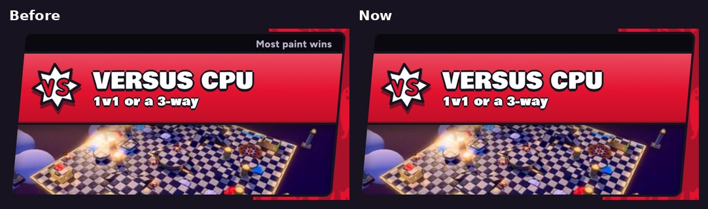

# v344: no "Most paint wins" on the Versus CPU card

- **The dark strip across the top of the Versus CPU card on Choose Event no longer says "Most paint wins".**
- The strip itself stays, empty, so the card keeps the same shape as the others.
- The other cards keep their words: Live online, Last one standing, Weekly leaderboard and Coming soon.
- The Online sheet's own header ("1v1 · Most paint wins") is unchanged.

## Tested
In the preview build, on a 390px-wide phone and sideways. 6 checks, all pass:
- **The Versus CPU card's strip has no words,** upright and sideways.
- **The strip is still there,** 22px tall and as wide as the Play Online card's.
- **The other cards keep their words:** Live online, Last one standing, Weekly leaderboard, Coming soon.

The same checks on v343 find "Most paint wins" on the strip.
