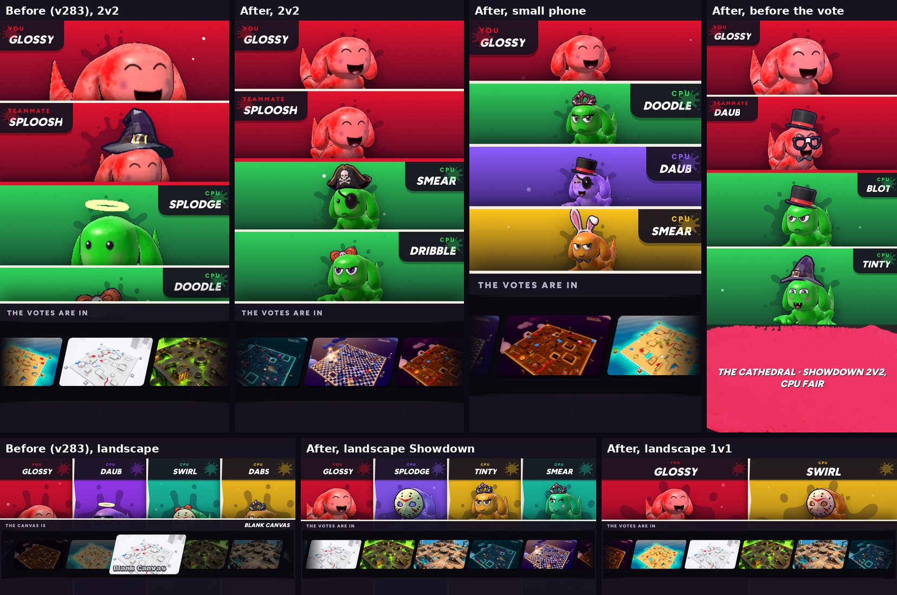

# Versus screen portraits, centred on any screen (v284)

The fight card's portraits now sit in the middle of their panels whatever the device. Built in `tools/v284_vs_center.py`.

Upright (one fighter per row):
- Four-player matches (Showdown, 2v2) framed each shot for a box twice the row's width (a rule for the side-by-side layout won over
  the rows' own), then rendered it squarer than the row and cropped it: heads low, cut off and soft. Each shot is now the row's own
  width and exact shape, so nothing is cropped and the picture is sharp.
- The head is framed in the middle of the part of the row you can see, across and down: below the screen's top inset (a notch, or an
  app's bar over the page) and above the title at the foot. Sizes come from the layout, not from where the slide-in animation has the
  rows at that moment.
- The canvas vote's panel used to come up over the bottom rows (on a 390x700 phone the last row showed only a halo). When a vote follows
  (every match but the first lesson's), the rows now end where the panel will come up; until it does, the bottom band and the title fill
  that space.

Landscape keeps its full-length fighters until the vote. When the vote's panel comes up (it used to cover all but the tops of their
heads on a phone), each head glides into the middle of what its panel still shows, between its name and the vote, smaller only if it
has to be.

Checked at 320x568, 375x667, 390x700, 390x844 and 430x932 upright (1v1, 3-way, Showdown, 2v2, before and during the vote), and at
844x390 and 1024x768 in landscape.
